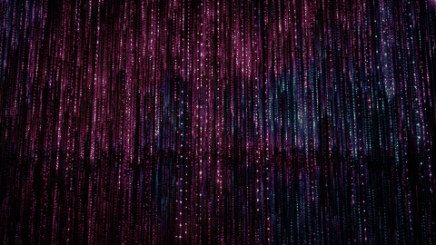
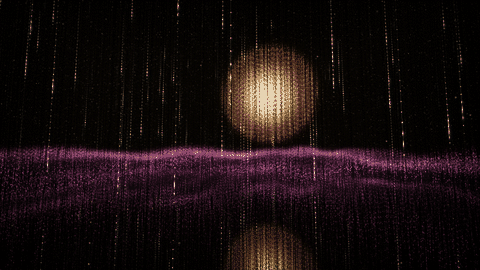
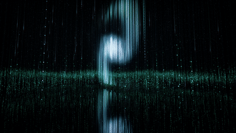
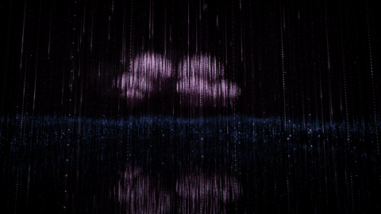
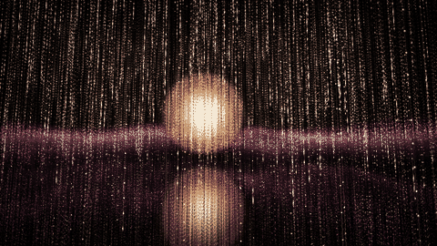

# Rain of Light

A room of small points of light over a mirror floor. Rain of light falls
through it; now and then the rain eases off and a large form of light gathers
in the room (an orb, a spiral, a cloud of points, a ring, a veil like an
aurora), or glows while the rain falls through it. The show moves between these on its own, with slow cross-fades. The
weather, the colours, the direction of the rain and the camera change on
their own too. Calm generative music plays along and follows the show, and
every ripple of light rings a bell.

<table>
  <tr>
    <td align="center"><br><sub>rain of light</sub></td>
    <td align="center"><br><sub>an orb in the still room, with the layer</sub></td>
  </tr>
  <tr>
    <td align="center"><br><sub>a spiral</sub></td>
    <td align="center"><br><sub>a cloud</sub></td>
  </tr>
  <tr>
    <td align="center" colspan="2"><br><sub>rain falling through a form</sub></td>
  </tr>
</table>

Plain WebGL2 and Web Audio: no build step, no dependencies, no media files.

Live: <https://sf624.github.io/rain-of-light/>

Inspired by teamLab's *Light Sculpture - Point*.

## Use

- **Click or tap**: a ripple of light (and a bell). **Drag** to look around: the picture follows the mouse or the finger.
- **Buttons, bottom right**: settings ⚙, full screen, a phone with an arrow (landscape / portrait; on touch screens only), sound ♪, volume.
- **Landscape / portrait**: the rotate button (or `r`) shows the picture in the other shape, also when the phone's rotation lock is on. Where the browser can lock the orientation (Android Chrome, in full screen or as an installed app) it does that; where it cannot (iPhone and iPad Safari, desktop) the page turns its own picture a quarter, so turn the phone to match. Pressing again goes back; really turning the phone also ends it.
- **Keys**:

  | Key | Does |
  | --- | --- |
  | `p` | settings panel |
  | `c` | next colour |
  | `w` | next weather |
  | `d` | switch direction (falling / sideways) |
  | `v` | next camera move |
  | `m` | sound on / off |
  | `f` | full screen |
  | `r` | landscape / portrait |

The screen stays awake while the page is showing (where the browser allows it).

Browsers start sound only after a click or a key, so the music begins with
your first click or key press (unless you turned the sound off: that is
remembered). A ripple also rings by itself now and then (Ripples in the
panel), and a breathing guide swells the light and the pad slowly (Meditation
in the panel; off with `?breath=off`). The settings panel keeps what you change in this browser
(Reset brings back the defaults). Any setting can also be given in the URL,
such as `?color=cloud&weather=drizzle`; `#tune` opens the panel. On a touch screen the panel scrolls with a finger anywhere, also over a slider: a slider moves only when you drag it sideways, and a tap on it does nothing; in portrait the panel is a sheet over the lower part so the picture stays in view.

The strands hang a little above the mirror floor, so a thin dark line runs
between each strand and its image; light that runs down a strand runs up its
image, towards that line. The show passes through:

- **rain**: rain of light, in the colour modes; while it falls the far
  strands fade into a mist;
- **a form**: the rain stops, and a form of light glows in the still room,
  with a few pale drops and a sparse twinkle;
- **rain through a form**: drops that pass through the form take its colour;
- **a still room**: only a layer of light near the floor, which also comes
  and goes beside the others.

The forms move, slowly, each in its own way, and the mirror floor shows each
move:

- **orb**: rises out of the floor, meeting its own image there, drifts and
  breathes; now and then it parts into two that drift apart and flow together
  again; it goes by sinking back into the floor;
- **spiral**: unfurls out of its bright core, its arms turning, and winds back
  into it as it goes; it turns its face to the room, leaning to and fro;
- **cloud**: a cloud of separate points in two colours that gathers as points
  fall into place, drifts across the room, now and then parts in two, and
  goes by rising away as points;
- **ring**: rises out of the floor lying flat, beside its image, then stands up
  and turns slowly; now and then it parts into two hoops that cross and come
  back into one; it goes by lying down and sinking into the floor;
- **veil**: a curtain of light like an aurora that unrolls from one end, its
  folds travelling slowly along it, its rays rising from a bright lower edge;
  it goes by lifting away upward.

The layer near the floor takes a colour that answers the form above it. A
form that comes or goes while rain falls does so from the top down, as if
rain gathered into it or it ran off as rain. Each passage lasts from about
20 seconds to over a minute, and each visit has its own order. `?seed=` (any
number) gives one order, and `?t=` (seconds) starts at that time in it.

The weather of the rain (drizzle, rain) changes on its own too; the heavy
ones, `shower` and `downpour`, never come by themselves: choose them with `w`
or the Weather setting. When the rain turns between falling and sideways, the
two cross-fade (Turn steps in the panel makes it turn in steps instead).

Scene in the panel (or `?scene=`) pins the content: `mix` (the default, the
whole show), `rain` (only the rain) or `crystal` (only the forms). It changes
without a reload. `?form=orb` (spiral, cloud, ring, veil, none) and `?layer=on` (off)
hold one form or the layer. `c` turns both the rain's colours and the forms'
colours; `w` changes the weather, which also sets how many pale drops fall in
a still room.

## What you hear

The music follows what you see, at the same moment and with the same slow
fades:

- **rain**: the hush of rain swells and eases with the rain, under a slow
  pad in D major, a little veiled;
- **a form**: as it gathers, a chord of its own blooms and the pad opens; each
  form has a voice that swells and fades with it, from the side where it is
  seen (it follows the form as it moves): the orb a warm, low hum, the spiral
  a slow figure of notes that climbs and turns, the cloud a high, airy
  shimmer, the ring a clear, glassy tone, the veil a soft, open air. As it
  leaves, the harmony comes home to D;
- **rain through a form**: both, fuller but not louder;
- **a still room**: close to silence: the pad thins out, and now and then a
  high, soft note falls, like the room's pale drops;
- **the breath**: a low tone under the pad swells as the light does.

Each ripple rings a bell. The panel's Sound settings set the volume, the pad,
the bells (also the still room's notes), the rain and the forms' voices.

Quality is automatic: if frames are slow, the canvas is drawn at a lower
resolution (down to half), and raised again when the device keeps up. Set
`Quality` to `full` in the panel (or `?quality=full`) to always draw at the
screen's full sharpness; `?dpr=` still sets the upper limit.

## Install and offline

On a phone or in Chrome / Edge you can install it ("Add to Home Screen" /
"Install app"): it opens full screen, and works offline after the first
visit. Online, you always get the newest files; offline, the last ones seen.

## Run locally

Any static file server will do, for example:

```sh
python3 -m http.server 8765
```

Then open <http://127.0.0.1:8765/>. Opening `index.html` as a file does not
work, because the scripts are ES modules.

## Files

| File | What |
| --- | --- |
| `index.html`, `style.css` | the page |
| `main.js` | the director that changes weather, colour, flow and camera, and the frame loop |
| `config.js` | palettes, colour modes, weathers, camera moves, forms, passages, the room, default settings and the panel's layout |
| `show.js` | the show's director: the timeline of passages, how much rain falls, which forms of light show, and how bright |
| `forms.js` | how each form of light moves through its life: where it is, how large and how turned |
| `shaders.js` | the GLSL shaders: the points of light, bloom and tone mapping |
| `lattice.js` | the strands and LEDs, and the order in which they thin out |
| `gl.js` | WebGL helpers and vector maths |
| `controls.js` | the sound, volume and full screen controls |
| `audio.js` | the music: pad, bells, rain, reverb |
| `sway.js` | 1/f fluctuation, used by the music and the rain |
| `wakelock.js` | keeps the screen awake while the page is showing |
| `tuner.js` | the settings panel |
| `manifest.webmanifest`, `icons/` | the install information and the app icons |
| `sw.js` | the service worker: network first, cached files when offline (add new files to its list) |
| `docs/` | the GIFs shown above |
| `tools/` | makes those GIFs (see below) |
| `test/smoke.mjs` | the smoke test (see Test) |
| `test/render-audio.mjs` | renders the page's sound to a WAV file, for listening and measuring (see Test) |

## Version

The link to this repository and the short commit hash being served are at the
bottom of the settings panel. GitHub Pages deploys through
`.github/workflows/pages.yml`, which writes `version.json` (the commit and its
date) into the site; the file is not committed, so a local server shows only the link.

## Test

```sh
node test/smoke.mjs
```

Needs Node 22 and Chrome (`google-chrome` or `chromium` on PATH, or set
`CHROME=/path/to/chrome`). It serves the repo, opens it in headless Chrome with
software GL, and fails on any error, a shown fallback message, a stalled frame
loop or a black canvas. It also clicks, presses the keys and tries every colour
mode, the pinned scenes (`rain`, `crystal`), the newer forms (`ring`, `veil`)
and a time part-way through the show, changes the scene in the panel (it must not reload) and checks that
Reset brings back the mix. It also renders a few seconds of sound offline and
checks that a held orb sounds, a still room is much quieter, and nothing
clips. GitHub Actions runs it on every pull request and push to main.

To hear (or measure) the sound without speakers:

```sh
node test/render-audio.mjs --query '?seed=4&t=118&weather=rain' --seconds 200 --out /tmp/sound
```

writes `/tmp/sound.wav` (and the samples as floats, and the show's state over
time as JSON). It runs the real page in headless Chrome on a fake clock, with
an OfflineAudioContext in place of the AudioContext, so the show drives the
sound exactly as it does live; see the top of the file for its limits.

## The GIFs

`docs/*.gif` are captured from the page itself, on a fake clock so that a run
is repeatable: `tools/scenes.json` lists the scenes (URL parameters, size,
length), `tools/capture-frames.mjs` saves their frames with Chrome, and
`tools/make-gifs.py` (Pillow, numpy) scales them to 480x270, cross-fades the
loop and writes the GIFs. They are not precached by the service worker.

```sh
node tools/capture-frames.mjs /tmp/frames   # needs Chrome; opens a window on the GPU
python3 -I tools/make-gifs.py /tmp/frames docs
```

## Licence

MIT, see [LICENSE](LICENSE).
