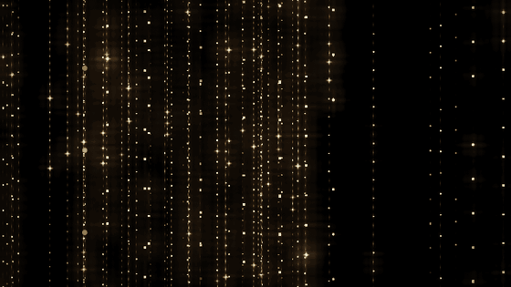

# Rain of Light

A field of small points of light, with rain of light falling through it.
The weather, the colours, the direction of the rain and the camera change on
their own, slowly. Calm generative music plays along, and every ripple of
light rings a bell.



Plain WebGL2 and Web Audio: no build step, no dependencies, no media files.

Live: <https://sf624.github.io/rain-of-light/>

Inspired by teamLab's *Light Sculpture - Point*.

## Use

- **Click or tap**: a ripple of light (and a bell).
- **Buttons, bottom right**: settings ⚙, full screen, sound ♪, volume.
- **Keys**:

  | Key | Does |
  | --- | --- |
  | `p` | settings panel |
  | `c` | next colour |
  | `w` | next weather |
  | `d` | switch direction (falling / sideways) |
  | `v` | next camera move |
  | `m` | sound on / off |
  | `f` | full screen |

The screen stays awake while the page is showing (where the browser allows it).

Browsers start sound only after a click or a key, so the music begins with
your first click. The settings panel keeps what you change in this browser
(Reset brings back the defaults). Any setting can also be given in the URL,
such as `?color=cloud&weather=drizzle`; `#tune` opens the panel.

## Install and offline

On a phone or in Chrome / Edge you can install it ("Add to Home Screen" /
"Install app"): it opens full screen, and works offline after the first
visit. Online, you always get the newest files; offline, the last ones seen.

## Run locally

Any static file server will do, for example:

```sh
python3 -m http.server 8765
```

Then open <http://127.0.0.1:8765/>. Opening `index.html` as a file does not
work, because the scripts are ES modules.

## Files

| File | What |
| --- | --- |
| `index.html`, `style.css` | the page |
| `main.js` | the director that changes weather, colour, flow and camera, and the frame loop |
| `config.js` | palettes, colour modes, weathers, camera moves, default settings and the panel's layout |
| `shaders.js` | the GLSL shaders: the points of light, bloom and tone mapping |
| `lattice.js` | the strands and LEDs, and the order in which they thin out |
| `gl.js` | WebGL helpers and vector maths |
| `controls.js` | the sound, volume and full screen controls |
| `audio.js` | the music: pad, bells, rain, reverb |
| `sway.js` | 1/f fluctuation, used by the music and the rain |
| `wakelock.js` | keeps the screen awake while the page is showing |
| `tuner.js` | the settings panel |
| `manifest.webmanifest`, `icons/` | the install information and the app icons |
| `sw.js` | the service worker: network first, cached files when offline (add new files to its list) |
| `test/smoke.mjs` | the smoke test (see Test) |

## Test

```sh
node test/smoke.mjs
```

Needs Node 22 and Chrome (`google-chrome` or `chromium` on PATH, or set
`CHROME=/path/to/chrome`). It serves the repo, opens it in headless Chrome with
software GL, and fails on any error, a shown fallback message, a stalled frame
loop or a black canvas. It also clicks, presses the keys and tries every colour
mode. GitHub Actions runs it on every pull request and push to main.

## Licence

MIT, see [LICENSE](LICENSE).
