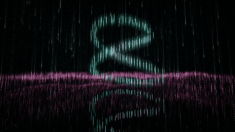
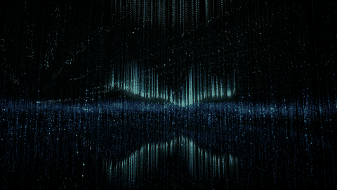

# Rain of Light

A room of small points of light over a mirror floor. Rain of light falls
through it. Now and then the rain eases off, and a large form of light
gathers in the room: an orb, a spiral, a ring, or a veil
like an aurora; or a form of mathematics: a solid (a tetrahedron, a cube,
a star) or a knot (a Lissajous figure, linked rings, a Möbius band);
or a ringed planet, Saturn or Uranus.
Sometimes the rain falls through the form. The show moves
between these on its own, with slow cross-fades. The weather, the colours
and the direction of the rain change on their own too, and the camera
circles the room slowly. Calm generative music follows the show, and every
ripple of light rings a bell.

<table>
  <tr>
    <td align="center"> rain of light</td>
    <td align="center"> rain falling through a form</td>
  </tr>
  <tr>
    <td align="center"> an orb in the still room, with the layer</td>
    <td align="center"> a spiral</td>
  </tr>
  <tr>
    <td align="center"> a knot</td>
    <td align="center"> a veil</td>
  </tr>
</table>

Plain WebGL2 and Web Audio: no build step, no dependencies, no media files.

Live: <https://sf624.github.io/rain-of-light/>

Inspired by teamLab's *Light Sculpture - Point*.

## Use

- **Click or tap**: a ripple of light, and a bell.
- **Drag**: look around. Sideways, the view turns about the centre as far as you drag, round and round; up and down, it rises and sinks a little.
- **Buttons**, bottom right: volume, sound ♪, full screen, settings ⚙. On a
  touch screen, a phone with an arrow turns the picture between landscape
  and portrait.
- **Keys**:

  | Key | Does |
  | --- | --- |
  | `p` | settings panel |
  | `c` | next colour |
  | `w` | next weather |
  | `d` | rain falling / sideways |
  | `v` | next camera move |
  | `m` | sound on / off |
  | `f` | full screen |
  | `r` | landscape / portrait |

The settings panel (⚙ or `p`) has a few settings: the rain, the form, the colour,
the brightness, the quality and the sound's levels. The lab,
[`lab.html`](https://sf624.github.io/rain-of-light/lab.html), is opened by
its address: the same page with every setting in its panel. Both pages keep what you
change in this browser; Reset brings back every default. Any setting can
also go in the URL, on either page. A few that people use:

| URL | Shows |
| --- | --- |
| `?rain=on&form=none&layer=off` | only the rain |
| `?rain=on` | rain that never ends, the forms coming and going through it |
| `?rain=off` | only the forms of light |
| `?form=orb` | always the orb (also `spiral`, `ring`, `veil`, `solid`, `knot`, `planet`, `none`) |
| `?color=cloud&weather=drizzle` | a colour mode and a weather |
| `?seed=7&t=120` | one order of the show, from 2 minutes in |
| `?breath=off` | no breathing swell of the light |
| `#tune` | the page with the settings panel open |
| `lab.html#tune` | the lab with its full panel open |

Every setting, key and URL parameter, with pictures:
[docs/settings.md](docs/settings.md).

The screen stays awake while the page is showing, where the browser allows it.

## Sound

Browsers start sound only after a click or a key, so the music begins with
your first one. (If you turned the sound off, that is remembered.) The music
follows what you see, with the same slow fades: the hush of rain and a slow
pad in D major; a voice for each form; near silence in a still room. The
Sound settings set the volume of each part.

## Install and offline

On a phone, or in Chrome or Edge, you can install it ("Add to Home Screen" /
"Install app"). It then opens full screen and works offline after the first
visit. Online you always get the newest files; offline, the last ones seen.

## Documents

- [docs/settings.md](docs/settings.md): what each setting does, with pictures.
- [docs/design.md](docs/design.md): how the app is built, explained plainly.
- [docs/development.md](docs/development.md): running it locally, the files,
  the tests and the tools.

## Licence

MIT, see [LICENSE](LICENSE).
