# Design of Rain of Light

This document explains how the page works, for a programmer who has not seen
the code. Each section says first what you see, then how the code does it.
References look like `file.js: name`: search the file for that name.

For what each setting does, see [settings.md](settings.md). For running,
testing and capturing, see [development.md](development.md).

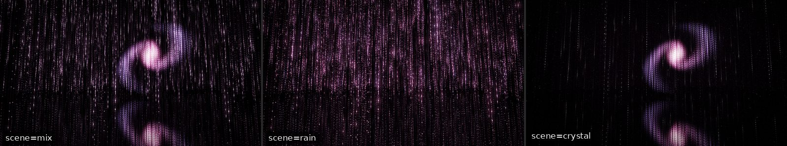

## 1. The idea and the constraints

You stand in a dark room full of hanging strands of tiny LEDs, over a floor
of black glass. Light falls down the strands like rain. Now and then the rain
stops, and a large form of light gathers among the same LEDs: an orb, a
spiral, a ring or a veil, or one of two forms of mathematics (a
solid, a knot). A low sea of light (the layer) glows near
the floor. The colours drift slowly together, and calm music follows what is
shown. A click sends a wave of light through the room and rings a bell.

Nothing is a picture or a model. Every light you see is one LED of the
lattice, lit more or less in each frame.

The constraints:

- **A static page.** It is served as plain files (GitHub Pages). There is no
  server code.
- **No build step.** The browser loads the ES modules as they are in the
  repository. The shaders are template strings in `shaders.js`.
- **No dependencies.** WebGL2 and Web Audio only. The tests and tools use
  Node 22 built-ins and Chrome (and Pillow for the GIFs).
- **One buffer of points.** The whole lattice is one static vertex buffer.
  Each pass draws it with one call. The rain, the forms, the ripples and the
  colours are all worked out per LED in the vertex shader.
- **A seeded show.** The show's timeline, the director's tracks and the
  places of the automatic ripples come from hashes of one seed (`?seed=`).
  A time (`?t=`) then shows one passage. Some things use
  `Math.random`: the strands' places and their own seeds and thinning ranks
  (`lattice.js: fillLattice`, so each drop's timing), the 1/f sways
  (`sway.js: createSway`: the rain's swell, the gaps between automatic
  ripples, the sound's sways) and the music's notes (`audio.js`). The
  capture tools seed `Math.random` in the page to make a run repeatable.

## 2. The room

### The lattice

You see a square field of vertical strands, each a line of LEDs. The strands
are not on an exact grid, so no straight dark lines cross the view.

`config.js: ROOM` sets the room: 36 units wide and deep (`span`), 15 tall
(`height`), centred on 0. The strands end 0.45 above the mirror floor
(`foot`). This leaves a thin dark seam between each strand and its image, so
you can see where the floor is. The eye stands 2.2 above the floor (`eye`)
and looks a little up (`pitch`).

`lattice.js: fillLattice` builds the buffers:

- `GRID × GRID` strands and `ROWS` LEDs per strand (`lattice.js:
  latticeSize`). By default they come from the setting `leds`, the number
  of LEDs in thousands (1000, or 210 on a small screen), and `aspect`, the
  spacing along a strand over the spacing between strands (1). So the
  LEDs are as far apart up and down as across, and a form is drawn as finely
  both ways. On a desktop that is 134 × 134 strands of 55 LEDs: 987,580
  LEDs, about 0.27 units apart. On a small screen, 80 × 80 strands of 33
  LEDs. The settings `grid` and `rows`, when not 0, set either number
  outright; the other follows at the spacing.
- Each strand is moved by up to half a step in x and z. Its LEDs are shifted
  by up to one row. The `grid` layout turns this off; `scatter` puts each
  LED anywhere in its strand's cell.
- The setting `jitter` (LED spacing; with the `strands` layout only) spaces the LEDs along a strand:
  evenly, a little uneven, per strand (`pitch`), or in clusters
  (`lattice.js: spacing`). An LED that is never lit is placed far below the
  floor, where the shader drops it at once.
- Per LED, attribute 0 (`aData`) holds x, u (0 at the top, 1 at the
  bottom), z, and the strand's random seed. Attribute 1 (`aRank`) holds the
  strand's rank, the LED's rank, and a gain.
- The wires are one line strip per strand, through its LEDs. Strips are
  parted by the primitive restart index `0xFFFFFFFF`. So each LED is worked
  out once for the wires, not once per segment.

The ranks are for thinning. The density can drop to a share of the strands
and of the LEDs. An LED is on while its rank is under the share. Ranks along
a strand come from bit reversal (`lattice.js: rowRanks`), so every share is
spread evenly. Example: on a strand of 8 LEDs, the order is rows 0, 4, 2, 6,
1, 5, 3, 7. At a share of one half, rows 0, 2, 4 and 6 stay: every other
LED. Each strand starts this order at its own row, and strands get random
ranks. One order shared by all strands (or a Bayer matrix across them)
would leave dark rows at the same heights, which show as straight dark
lines.

Changing `leds`, `aspect`, `grid`, `rows`, `layout` or `jitter` rebuilds
the buffers, 250 ms after the slider stops (`main.js: apply`).

**Light on any lattice.** The gains are set for a lattice of 72 strands a
side with 96 LEDs each (`lattice.js: LIGHT_LATTICE`). On another lattice,
`lattice.js: latticeLight` scales the light so that the room shows as much
of it per volume, whatever the number of LEDs:

- The forms, the waves and the light at rest: per LED, by the volume each
  LED stands for (`uLight.x`), and per wire by the floor area each strand
  stands for (`uLight.y`). On a denser lattice each LED is dimmer. On a
  sparser one each LED keeps its light, so that room is darker: there the
  LEDs stand apart and are seen one by one, and brighter ones would glare.
- The rain: a drop is as long and as bright as there. Its head stays
  about one LED long, and its light is shared among the LEDs it passes
  (`uRainK[1]`, `uRainK[2]`), up to twice an LED's light where the LEDs lie
  farther apart (`DROP_MAX`). The share of strands that carry rain
  (`uRainK[0]`) then gives the rain as much light per volume as the room:
  as many rainy strands per area as there. Example: on the desktop lattice
  only 28% of the strands carry rain at a share of 1, and on 55 LEDs a
  strand each LED of a drop has 1.75 times the light.
- The twinkle: one LED in five there, fewer on a denser lattice
  (`uLight.z`), so as many twinkle per volume.

A frame costs about as much per LED, whatever the light: the vertex shader
runs once per LED (and again for its image and its wire).

### The mirrors

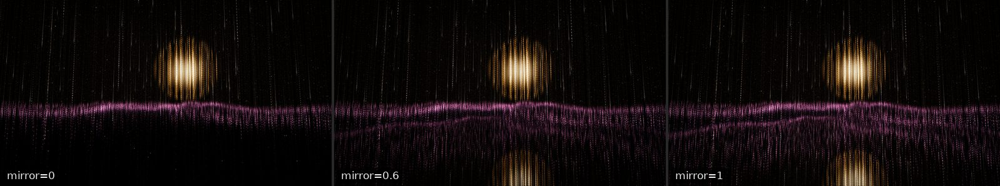

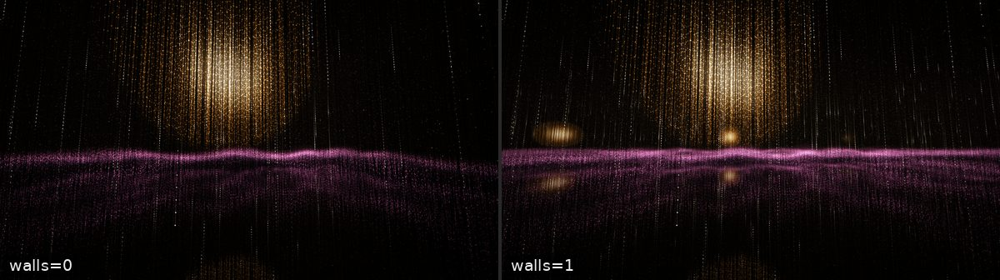

You see each LED again in the floor, upside down, fading with height as on
dark glass. With wall mirrors on, the room repeats beyond its walls.

A mirror image is the same lattice drawn again at another place:

- **The floor.** The whole lattice is drawn a second time with the uniform
  `uMirror` set. The vertex shader then places the LED at
  `2 · floor − y`, and scales its light by the setting `mirror` and by
  `exp(−height / MIRROR_FADE)` (`main.js: MIRROR_FADE`, 22 units). The
  falling rain's image is also fainter where you look down at the floor
  than at a glancing look (see "How the falling rain fades with distance").
- **The walls.** With `walls` at 1, each draw is instanced 9 times: the
  room itself and its 8 neighbours. `main.js: placeImages` gives each
  instance a sign flip and an offset in x and z, and a gain of 0.7 per
  reflection (0.49 at a corner). The walls stand half a strand spacing
  beyond the outer strands.

The light of an image is worked out at the LED itself (`pos` in
`POINT_VS`), and only drawn where its image is (`seen`). So each image is a
true reflection, not a second light.

### The camera and the narrow-view fit

The eye moves on its own, in one of five moves (`config.js: CAMERAS`;
`main.js: cameraPose`): orbit, walk, spin, gaze and rise. All run on one
clock, `camClock`, so a blend of two moves is smooth. A new move blends in
over `CAMERA_BLEND` (8 s). The default setting is `orbit`; with `auto`, the
director picks moves. A drag turns the view about the centre and raises or
lowers the eye.

A view narrower than 16:9 would show too little of the room. So
`main.js: viewFit` zooms out with the shape of the view. With
`need = max(1, (16/9) · H / W)`, how many times too narrow the view is:

- The field of view opens: `tan(fov/2)` grows by `need^0.2`, up to 96°
  (`FOV_MAX`).
- The eye steps back: the distance grows by `need^0.35`, but stays inside
  the room.
- The visible distance grows by half as much as the eye stepped back.
- In a view as tall as a phone's, the eye looks level (`TALL.pitch`), and
  the forms float up to 1.6 times higher over the floor (`TALL.rise`).

Example: a phone held upright (9 : 19.5) is 3.85 times too narrow. The field
of view opens from 76° to about 91°. The eye steps back from 10 to about 16
units. It sees about 30% farther. It looks level, and the forms float 1.6
times higher. At 16:9 and wider, nothing changes.

## 3. One frame, step by step

`main.js: frame` runs once per `requestAnimationFrame`:

1. **Clock.** `dt` is capped at 0.05 s. `main.js: adapt` looks at the frame
   time (see section 8). `main.js: resize` sizes the canvas and the render
   targets.
2. **Camera.** The moves are blended, the drag is applied, and
   `viewFit` is applied. This gives the view and projection matrices.
3. **Automatic ripple.** About every `ripples` seconds, a wave starts at a
   place drawn from the seed.
4. **Director.** `main.js: direct` asks each track (weather, colour, density,
   camera) for its episode at this time. A new episode runs its `BEGIN`
   function.
5. **Easing.** `main.js: ease` eases the rain's speed, amount, density and
   colours towards their goals, and moves the falling time (`look.flow`).
   It also updates the direction (`direction.js`).
6. **The show.** `show.update` says how much rain falls, which forms show,
   where, how bright, and in which colours.
7. **Sound.** The rain level, the breath and the forms go to `audio.js`.
8. **Uniforms.** The same uniforms are set on the LED and wire
   programs. Both share `POINT_VS`.
9. **Points.** With additive blending (`ONE, ONE`) and no depth test, the
   LEDs, then the wires are drawn into a half-float buffer; each LED draws
   its light rays into a second buffer beside it (see "The draws"). Then the
   floor's image is drawn the same way (without rays).
10. **Glow.** The buffer is downsampled to a quarter (only light past a knee),
    blurred, and, for the haze, downsampled and blurred twice more.
11. **Composite.** Glow and haze are added to the scene, then tone-mapped,
    vignetted and dithered onto the screen.

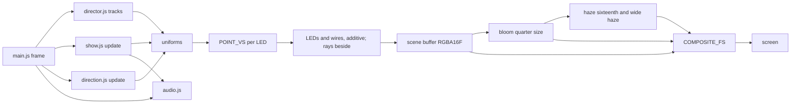

### The draws

`main.js: frame` draws up to four times per frame: LEDs (with their rays) and
wires, then LEDs and wires again for the floor's image. Each is one call over the whole
buffer (`drawArrays`, or `drawArraysInstanced` with 9 wall images). The wires
use `drawElements` with `LINE_STRIP`.

- **LEDs** (`POINT_FS`). Each LED has the same physical size
  (setting `size`). Its size in pixels is `size · focal / distance`, clamped
  between 1.5 px and `maxPx`. Below 1.5 px the LED keeps 1.5 px and dims
  instead, so far LEDs do not shimmer. The sprite is a pixel wider on each
  side. Each pixel gets the part of the LED's square that falls on it, so an
  LED gives the same light wherever it sits between pixels.
- **Wires** (`WIRE_FS`). One pixel wide, lit with the light of the LEDs
  along them. Thinned strands lose their wire; thinned LEDs do not.
- **Rays** (in `POINT_FS`, in the LED's own sprite, made larger when its
  rays are longer). Every bright point casts them: a drop's head, a form,
  the layer, a wave, a twinkle (not the rain's trails, nor the light at
  rest), never in the floor's image. A ray's length follows that
  light as seen (after the fog, the mirror, thinning and the fade near the
  eye, with far LEDs dimmed as in a 1080 px tall view):
  `rayLength · light / RAY_LIGHT` (`shaders.js: rayK`, `RAY_LIGHT` 3), at
  most `RAY_CAP` (2.5) times the setting, scaled to the view. A near, bright
  head casts a long ray; a far, dim one a short ray; a ray grows in and out
  with its head. The sprite is `2 · length + 1` px wide, with 2 to 8 thin
  lines through it. A ray under 0.75 px (`RAY_MIN`) is not drawn, and a
  short ray is faint, so none appears at once. A longer ray is a little
  dimmer along its length, so a near head does not flare. The rays' light is
  0.3 of the LED's (`RAY_GAIN`).
  The rays go to a second buffer of the scene (`COLOR_ATTACHMENT1`), where
  they share a budget of light: a ray of light s over the rays already
  there (d) gives `s + d · (1 − s / RAY_BUDGET)` (blend
  `ONE, ONE_MINUS_SRC_ALPHA`, the ray's alpha `s / RAY_BUDGET`, at most 1;
  `RAY_BUDGET` 0.12). The LED's own light, in the first buffer, has alpha 0,
  so it simply adds. A ray alone keeps all its light; the rays of a form's
  crowded LEDs stay near the budget, a soft sparkle, not a white sheet. The
  first step of the glow and the composite add the two buffers. Without
  float buffers there are no rays.

### Glow and tone mapping

The render targets are made in `main.js: resize`: the scene at full size,
the bloom at a quarter (`W >> 2`), the haze at a sixteenth, and a wide haze
at a sixty-fourth.

- `DOWN_FS` averages four reads. With a knee it takes the knee off the
  brightest channel and keeps the colour. `BLOOM_KNEE` is 0.5 and
  `HAZE_KNEE` 1.5. So dim LEDs and wires give no glow at all.
- `BLUR_FS` is a 9-tap Gaussian, run once in each direction (twice for each
  haze level).
- `COMPOSITE_FS` adds the bloom (times `bloom`) and the haze (times `haze`).
  The haze is read with a smooth cubic filter (`smoothRead`), because a plain
  read of so coarse a texture shows soft boxes. Glow fainter than
  `blackFloor` fades to nothing, so the space between the points is true
  black. Light far past white loses its colour (`burn`). Then
  `1 − exp(−c · exposure)` tone-maps, a vignette darkens the corners, and a
  dither breaks up banding (faded out near black).

Without float render targets (no `EXT_color_buffer_float` or
`EXT_color_buffer_half_float`), the points draw straight to the screen with
the exposure in `uGain`, and there is no glow and there are no light rays.

## 4. How one LED's light is decided

All of this is in `shaders.js: POINT_VS`, in `main()`. Per LED and per
frame, the shader computes three kinds of light: rain, forms, and waves. It
then mixes two looks: the rain's look and the still room's look.

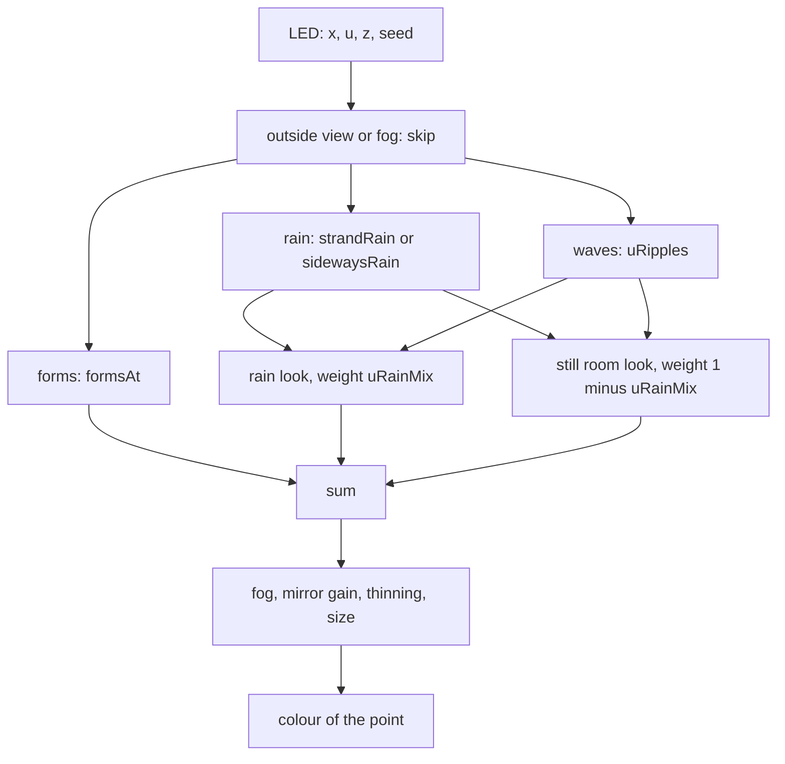

### Skipping work first

The shader first finds where the LED (or its image) is on screen. An LED out
of the view (`uCull`), beyond the fog, or behind the eye is placed outside
the clip volume and does nothing more. An LED within 1.2 units of the eye is
also dropped; it fades out from 2.2 units on, so none goes out at once.

### Rain falling down

You see drops of light run down a strand, a bright head with a trail behind
it. In heavier weather more drops join and the trails grow longer.

`shaders.js: drop` describes one drop on a line of LEDs. From the drop's
number it draws a speed (0.07 to 0.34 strand lengths per unit of falling
time), a period (1.3 to 2.8) and a trail length. The head is at
`fract(c) · period`; past the end of the strand the drop waits for the rest
of its period. Behind the head the light falls off as `exp(−d / trail)`.

Example: in `rain` weather the falling time runs at about 1 unit per second. A
drop of speed 0.2 and period 2 runs down the strand in 5 s, then is out of
sight for 5 s, then starts again at the top.

`shaders.js: strandRain` puts two drops on each strand, and two more that
join as `uRain` (the weather's amount) rises. `config.js: WEATHER` sets the
speed (`flow`) and amount (`rain`) of each weather.

Not every strand carries rain. `shaders.js: rainOn` lights a strand's rain
while its hash is under the share (`uRainShare`). Strands near the edge of
the share fade over 30% of it (`SHARE_FADE`), so no strand's rain switches
on or off at once. In a still room the share is 3 to 8% (the pale drops).
In a rain passage it is the setting `rainShare`, less a third under a form.

The falling time `look.flow` is integrated in `main.js: ease`, so a change
of speed never makes drops jump. It wraps at `FLOW_WRAP` (1000). Each drop's
rate is rounded so that it runs a whole number of cycles in 1000 units:
the wrap is seamless, however long the page runs.

### How the falling rain fades with distance

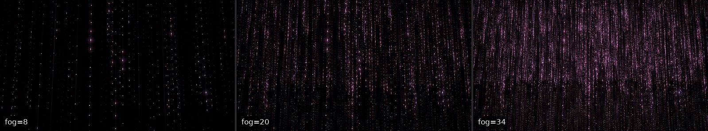

Near strands stand out bright, and far ones fade into a dim mesh behind
them, as in a real room. Otherwise the rain fills the view evenly, like a
pattern. Three things do it, in `POINT_VS` (`phys`), for the falling rain's
look only (the forms, the still room and the sideways rain keep the plain
fog), as much as falling rain shows (`uFallLight`: the rain's weight times
how much of it falls rather than flows):

- **Light by distance.** An LED under 1.5 px keeps 1.5 px and dims (see
  "The draws"), so its light falls as 1 / distance. The falling rain dims
  further by `(px / 1.5)^FALL_DIM` (0.65), measured as in a 1080 px tall
  view: its light falls as about 1 / distance^1.65. Its wire dims the same
  way from 4 units on.
- **Mist.** In place of the fog's band (full light up to 30% of the visible
  distance, then a fade), the light thins along the way to the eye:
  `exp(−distance / (MIST · visible distance))`, `MIST` 0.68. The distance
  is along the ray, so the edges of a wide view see no farther than its
  middle. It still ends at the visible distance.
- **The floor's image.** It is fainter where you look down at it than at a
  glancing look (Schlick's Fresnel): from `FLOOR_MIN` (0.7) of its light
  straight down to all of it towards the far end.

`FALL_GAIN` (1.8) keeps the picture as bright as with the plain fog. Example:
at 1280x720 in `rain` weather, the mean brightness is the same as with the
plain fog. In a phone's tall view it is about 85% of it, and the floor's
image still shows in the lower half.

**Near heads.** A near drop's head would get the lattice's share of a
drop's light (up to `DROP_MAX`), the near light and a large sprite at
once, and swell into a blurred ball in the glow. Its light per pixel is
capped (`POINT_VS: HEAD_MAX`, 2 heads' light at 1.5 px, less by the
sprite's area as it grows), so no head gives more light in all than one at
1.5 px. Farther heads keep their light and still dim with distance; the
trails are not capped. In a phone's tall view this takes about 6% off the
mean brightness of falling rain, at 1280x720 about 4%.

### Rain flowing sideways

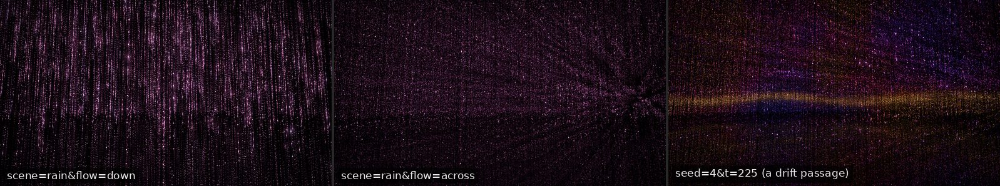

In a `drift` passage, light flows horizontally through the room, each time
in a new direction. `shaders.js: sidewaysRain` cuts the room into thin
horizontal tubes (lanes) along the flow direction `uFlowDir`. A lane is one
strand spacing wide and one LED spacing tall (`uLane`). Each lane carries
drops like a strand does, with `along` (0 to 1 across the room) in place of
`u`. Sideways trails are longer.

A rain never turns. See section 5 for how the direction changes.

### The colours of the rain

The rain has eleven colour modes (`config.js: COLOR_MODES`), passed to the
shader as weights `uW` (one weight per mode). Normally one weight is 1. The
modes are coloured in four places:

- `flowColor`: colours that flow with the light: one palette (`mono`), a
  flowing two-palette gradient, rainbow bands. The bands slide down at
  about the speed of a drop (`uBandShift`).
- `placeColor`: colours of the place: drifting clouds of colour (`cloud`,
  3-D noise), one colour near and one far (`depth`), the colour the last
  wave painted (`repaint`), and the sky through one day (`sky`,
  `config.js: SKY`).
- `dropColor`: colours that a drop keeps: a random hue per drop (rainbow),
  a pick from a set (`palette`), a rare accent drop (`accent`), warm slow
  drops and blue-white fast ones (`speed`).
- `gather`: the comet mode's white head and coloured trail (`HEAD`).

A colour change never blends two colours, which goes through grey. Instead,
the shader gets two looks (each uniform is an array of two). Each strand
shows one of them. As `uSide` goes from 0 to 1 over 7 s (`main.js: SWITCH`),
the strands go over to the new look one after another, each from the top
down. `main.js: BEGIN` (its `color` function) writes a new episode into the
look that no strand shows.

### Forms of light

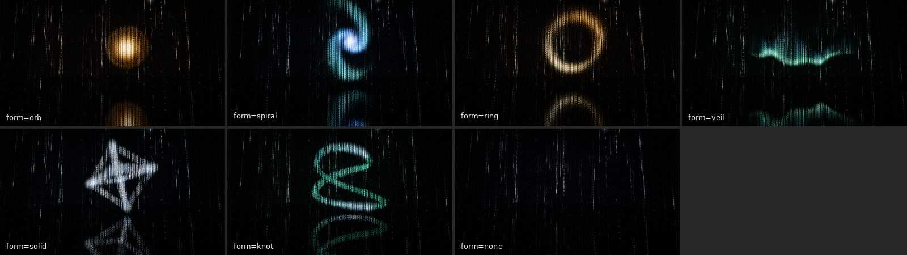

`shaders.js: formsAt` adds the light of up to three forms: two sky forms
(one coming, one going) and the layer. For each it calls a function that
gives, at the LED's position, the light, a white-hot share, and a mix from
the form's first colour to its second:

- `orbLight`: a ball, pale at its heart, deep at its thin rim. It may part
  in two.
- `spiralLight`: a tilted disc with two arms and a bright bulge, slowly
  turning. It unfurls from its core.
- `ringLight`: a hoop, a bright thread in a soft sheath, with two brighter
  arcs. It may part into two crossing hoops.
- `veilLight`: a curtain like an aurora, in travelling folds, with a bright
  lower hem and rays rising from it.
- `solidLight`: the edges of a tetrahedron or an octahedron (`SOLID`,
  `CORNER`, `EDGE`). The distance to each edge is that from a point to a
  straight piece of line, worked out exactly, 6 or 12 times. Each edge
  is a rod of even light with a clean edge (`rod`), dark around and
  inside the solid, and shows from its two corners inward, as far as it
  is drawn. Each corner is a white-hot point. The solid stands on the axis
  of a corner and leans at most 0.4 rad (`forms.js: solid`), so every edge
  runs aslant or level: an edge along a strand would light one strand or
  none.
- `knotLight`: a Lissajous curve, `x = sin(u t + p)`, `y = sin(v t)`,
  `z = sin(w t + q)` with `u, v, w` = 2, 1, 3 (`KNOT`): it swings twice
  across while it goes once up and down, so it runs aslant or level and
  hardly ever along a strand. The phase sways about 0, where the loops
  stand widest, and stays well short of a quarter turn, where they close
  into one line (`forms.js: KNOT_SWAY`). The LEDs are dense along a
  strand, so the shader starts from the LED's height: the curve passes
  that height at `2 v` values of `t` (2). From each it takes one step
  along the curve's tangent towards the LED, and keeps the nearest place
  found. The cost does not grow with the curve's length. The line is a
  rod of even light (`rod`); two lights run round it (`runner`).
- `layerLight`: the layer of light, a sea near the floor in slow waves, its
  points glinting.

Each is a field: a function of the LED's position relative to the
form's centre, size and turn. Where the form is moves in `forms.js` (see
section 5). Each form also has a reach (`uFormF[k].w`, the `bound` from
`forms.js`). LEDs beyond it skip the form, so a form costs little where it
is not. The knot also stops early outside its own box.

The thin forms (ring, veil, solid, knot) are about as thick as the gap
between strands on a lattice of 72 a side (half a unit), or as one strand
gap on a coarser lattice (`shaders.js: fineness`; `rod` for the solid and
the knot), so a coarse lattice still catches them. A denser lattice leaves
them as thick, and draws them with more strands.

**Coming and going.** A form does not fade evenly. Each LED has an order
from 0 to 1. The LED is on while the form's weight is far enough past its
order: `on = clamp((1.25 · weight − order) / 0.25, 0, 1)`, times
`smoothstep(0, 0.4, weight)` so that a faint form is faint everywhere
(`shaders.js: formsAt`). Example, leaving that factor aside: at a
weight of 0.5, an LED of order under 0.375 is fully lit, one over 0.625 is
dark, and those between are partly lit. Normally the order is random per
LED, so a form gathers LED by LED. While rain falls (not sideways), the order follows the
height (`uFormE[k].x`), so a form comes from the top down, as if rain
gathered into it, and goes from the top down, as if it ran off as rain.
A form that rises away as points (`uFormE[k].w`, the veil)
shows each LED's light a random way below it, so the light lifts off.

**Colour.** The light is the form's first colour mixed towards its second,
then towards `WHITE_HOT` by the white-hot share. Sky forms give 1.25 times
their own light (`FORM_BODY`).

**The layer** gives way where a sky form already lights the LED, so the two
never add up to a white flare. It is dark within 4.5 units of the eye and
full from 11 units away (`LAYER_NEAR`), so it never shows as big loose points across the
floor.

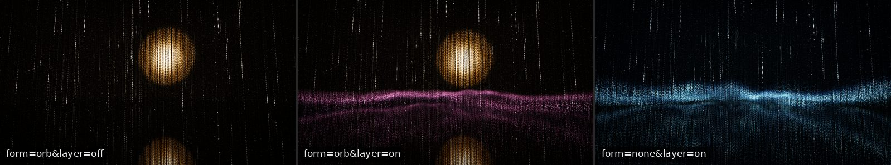

### Waves of light

A click, a tap or an automatic ripple starts a spherical wave
(`main.js: addRipple`; 8 at most at once, in `uRipples`). The front moves at
3.6 units per second and lives 7 s. It has a crisp front and a wake that
fades behind it. It swells in over its first 0.3 s. In a still room the wave
is a level band, like a ring on water; in rain it is a full sphere.

`main.js: rippleAt` aims the wave 10 units along the ray from the eye
through the tapped point. A tap on the floor's image rings the LED whose
image it is.

### Twinkle

In the still room's look, one LED in five (fewer on a lattice denser than
72 strands a side; see section 2) blinks now and then, sharply
(a sine raised to the power 30), each at its own pace. The setting
`twinkle` scales it.

### How it all combines

In simplified form (see the end of `main()` in `POINT_VS`):

```
c = form + flare · 2.5 · ring                       the forms, lifted by waves
  + rainLook  · rk · (1 − 0.25 · storm) · (1 − 0.75 · around · (1 − inForm))
  + stillLook · (1 − rk)

rainLook  = rest colour · rest + trail colour · rain · rainGain
          + head colour · tip · tipGain + a whitened rest colour · ring · 4
stillLook = room tint · rest + pale · twinkle
          + pale drop · (rain · rainGain · 0.5 + tip · tipGain) + pale · 5 · ring
```

- `rk` (`uRainMix`) is how much rain falls now: 0 in a still room, 1 in a
  rain passage. The still room's look is faint, in the colour of the room
  (`uTint`, the colour of the forms that show).
- `storm` is how much rain falls through a form. Then the rain takes the
  room's colour and dims, so the form stays the subject.
- `around` is how near the LED is to a sky form. Rain gives way there.
- `inForm`: a drop that runs through a form takes the form's colour.
- A wave lifts a form's light at most to white (`flare`).
- `form`, `ring` and `rest` are scaled by `uLight.x`, and `rain` and `tip`
  carry each LED's share of a drop's light, so the room is as bright on any
  lattice (see [the lattice](#the-lattice)).

The result is then scaled by the fog, by the mirror's gain, by thinning
(`aRank` against `uDensity`), and by the size dimming. The rain's look is
also scaled by `phys` (see "How the falling rain fades with distance"). An
LED whose light is almost nothing is dropped.

## 5. The show

### Passages

The show is a timeline of passages (`config.js: PASSAGES`;
`show.js: createTimeline`):

| Passage | What you see | Hold (s) |
| --- | --- | --- |
| `rain` | rain of light | 36–70 |
| `form` | a form of light in the still room | 40–66 |
| `storm` | rain falls through a form | 30–52 |
| `still` | only the layer, and sparse pale drops | 18–32 |
| `drift` | rain that flows sideways | 30–48 |

Each passage says how much rain falls (`rain`), whether a sky form shows
(`sky`), and the chance that the layer glows (`layer`). `weight` is how
often it comes.

`show.js: createTimeline` (its `extend`) makes the passages one after
another, from hashes of the seed and the passage's number:

- The first passage is short (30–46 s).
- The same kind twice running is rare, and a still room never follows
  itself (`pickKind`).
- A `drift` passage comes only next to a form passage (`fits`). A form lasts
  long enough that the rain before it has gone first.
- A sky passage next to one of the other kind (a storm after a form, or a
  form after a storm) may keep the form that already shows (60%), so rain
  gathers on it or runs off it.
- Otherwise the new form is never one of the last two. Each of the others
  is as likely as its weight (`config.js: FORMS`: 1 for the orb, spiral,
  ring and veil, 0.4 for the solid and knot)
  times the square of how many forms have come since it last did. Over an
  hour a form comes about 36 times: each of the first four about 6.6 times, the
  solid and the knot about 5 times (`tools/story-stats.mjs`).

The scene setting chooses a pool (`show.js: POOLS`): `mix` uses all
passages; `crystal` uses only `form` and `still` (and `still` half as
often); `rain` is rain alone, with no timeline.

### Fades: no cut

Each passage hands over to the next on three channels: the rain, the sky
form and the layer. Each channel starts at its own time and fades at its own
pace (`show.js: RAIN_IN`, `RAIN_OUT`, `SKY_IN`, `SKY_OUT`,
`SKY_INTO_RAIN`, `LAYER_IN`, `LAYER_OUT`). Rain comes early and leaves late.

Example: a form passage starts at 100 s after a rain passage. The form
begins to gather at 98 s and is full by 110 s (`SKY_IN`). The rain begins to
leave at 104 s and has gone by 120 s (`RAIN_OUT`). So the form seems to
gather out of the rain.

`show.js: createShow` (its `update`) also eases the shown weights over
2.5 s (`EASE`). A change of scene or of the Form setting then blends in.

### Casting: slots and placing

`update` puts the forms into three slots: two for sky forms and one for the
layer (`SLOTS`). A form keeps its slot while it shows, because the order in
which its LEDs light depends on the slot. `show.js: place` fills the
uniforms `uFormA` to `uFormF` for each slot: type, weight, size, turn,
centre, tilt, how it comes and goes, its own measures and its reach.

Where a form is comes from `forms.js: motion`, as a function of its age and
of how far it has gone on its way out. Each form has a life of its own
(`forms.js: orb`, `spiral`, `ring`, `veil`, `solid`,
`knot`). For example, the orb
rises out of the floor to meet its image, drifts, parts in two now and then,
and sinks back as it leaves. The ring rises lying flat, stands up, and lies
down into the floor as it goes. The forms slowly turn to face the eye (eased
over 5 s), and keep a little beyond their path as the eye sees them
(`forms.js: BACK`).

Among rain, a sky form glows up to 1.8 times brighter (`STORM_GAIN`), to
hold its own. The layer has its own height, thickness and brightness each time. It
is brighter and wavier when it has the room to itself.

### The director's tracks

The rain's own look changes on separate tracks (`director.js`):

- `weather`: drizzle and rain. Shower and downpour have weight 0: they come
  only by the `w` key or the Weather setting.
- `color`: the colour mode and its colours (two palettes, a set, an accent,
  near and far colours, a cloud hue).
- `density`: the share of strands and LEDs, between the lower limits and
  full. The thinning grows with how much rain falls (`uDensity` is
  `1 + (density − 1) · rk`), so it reaches a form only in a storm.
- `camera`: the camera move (used when the Camera setting is `auto`).

A track (`director.js: createTrack`) is a list of episodes. Each has a hold
time and is made from `hash(seed, track, number)`. `listTrack` never picks
the same item twice running. The `skip` method ends an episode early: the
`w`, `c` and `v` keys use it while their setting is `auto`. A setting other
than `auto` holds its choice over the track (`main.js: chosen`).

### The colour story

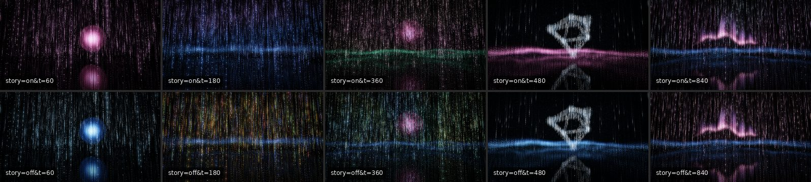

With the colour story on (setting `story`), the colours of neighbouring
passages belong together. They drift from cool to warm and back.

`director.js: createMood` makes a mood: a hue that wanders along an axis.
The stops are the hues of the four coloured palettes, in order: aurora
(about 155°), deep sea (223°), sakura (330°) and amber (26°, counted as
386°). It never crosses yellow-green, where no palette lies. Each leg goes
from one stop to the next and takes 120 to 180 s (`MOOD`). It mostly keeps
going the same way, always after a turn, and turns back at the ends. From
deep sea to amber takes 4 to 6 minutes.

Choices lean to the mood (`director.js: leaning`, `suits`):

- A colour 32° away from the mood is a quarter as likely (`NEAR`).
- One choice in five is free of the mood, so surprises still come (`FREE`).
- Modes of many colours at once (rainbow, speed, depth, repaint, sky) are a
  quarter as likely when the choice leans (`MANY`).
- The rain's mode and colours, each form's palette and the layer's palette
  all lean the same way.

The dwell rule (`show.js: TIRE`): once the forms have kept one family of
hues (within 50°, `KIN`) for 90 s, palettes of that family are 20 times
less likely for the next form. So no one colour holds the room for long.

The director keeps two colour tracks: `color` (the seed alone) and `story`
(the same random numbers, leaning to the mood). With `story=off`, each
choice is made as if there were no mood.

The layer under a form takes a palette that sets the form off
(`show.js: UNDER`). It is never the form's own and never a pale one. Under
a pale form (ice, candle), the room takes the colour of its ground.

### No cycle

The show does not loop. The timeline and the tracks are lists made on
demand from hashes of the seed. Each new passage depends on the last ones
(no repeat of the last two forms, the dwell rule), so `extend` builds them
in order up to the time asked. The show's timeline and tracks never repeat.
(Some motions are periodic: the sky's day, the camera moves, the breath.) The
only wraps are internal: the falling time and the band shift, which wrap
exactly (section 4).

### `?seed=` and `?t=`

`?seed=N` fixes the seed (`main.js: SEED`); without it each visit draws its
own. `?t=S` starts the show at that time. The camera clock, the falling
time and the sky clock start there too, and `main.js: direct` applies the
episodes of that time at once. So `?seed=7&t=100` always opens on the same
passage, form, colours and camera, up to the strands' exact places.

### Changing direction

The rain either falls or flows sideways, never both at once
(`direction.js: createDirection`). The show wants sideways rain from a
little before a `drift` passage until its rain has gone
(`show.js: flowAt`). Because drift comes only next to form passages, the
direction changes only while no rain passage falls. Then only the few pale
drops change.

A change goes like this. The old direction's gate closes: drops that set
out before now keep running; no new ones start. The old rain fades out over
4 s (`CHANGE / 2`). Only when it has gone does the new direction's gate
open. Only drops that set out from now on show, so the first ones start
from where drops start (the top, or the far side), and fade in. Each drop
knows when it set out: in `shaders.js: drop`, `born` is compared with the
gate (`uGate`).

A new sideways rain takes a new direction each time (`main.js: ease` sets
`flowDir`). The `d` key and the Direction setting hold one direction; they
change it the same way.

## 6. Sound

The music is made live with Web Audio, with no sound files
(`audio.js: createAudio`). Browsers start sound only after a click or a
key. The sound is on unless the listener turned it off; it starts with the
first click or key (`controls.js`).

The layers:

- **Pad.** Slow chords in D major (`CHORDS`: D add9, Bm add9, G maj9,
  A sus2, Em9), any of which may follow any other. Each note is a sine, a
  triangle and a faint saw through a low-pass filter (`padChord`,
  `sustain`). A chord holds 14 to 20 s; the next swells as it fades.
- **Low tone.** The root an octave down, under the pad, swells with the
  breath.
- **Bells.** Each wave of light rings a bell like a small singing bowl
  (`bell`, `PARTIALS`), panned to where the wave is seen. Its pitch is a
  1/f melody on a D major pentatonic scale (`BELLS`).
- **Rain.** Looped pink noise, band-limited. Its level follows the weather,
  the same 1/f sway as the light rain, and how much rain falls.
- **Form voices.** Each form has a voice that swells and fades with its
  weight, panned to where it is seen (`mixVoices`): the orb a warm low hum,
  the spiral a slow figure of notes (scheduled in `tick`), the ring a glassy tone, the veil a soft air, the solid a chord
  of three pure fifths, the knot two tones that beat at different paces.
  The veil also gets a little high noise (`AIRY`).
- **Pale drops.** In a still room a high, soft note falls now and then.
- **Reverb.** A 6 s convolution reverb (`impulse`), then a compressor.

What drives them, from `main.js: frame` every frame:

- `sound.rain(amount, sway, falling)`: the weather's amount, the sway, and
  `rk`.
- `sound.forms(list)`: each sky form's name, weight, whether it has begun
  to go, and its pan.
- `sound.breath(k)`: the breath (section 7).
- `sound.ripple(pan)`: from `main.js: addRipple`.

How the harmony follows the show: a form that arrives brings its own chord
(`FORM_CHORD`; `arrive`), unless a chord began less than 6 s ago
(`SETTLE`). A form that leaves with none coming takes the harmony home to
D (`HOME`; `depart`). The pad's filter opens with a form, closes in rain,
and the pad thins out in a still room (`tick`, `mixPad`). What changes
slowly sways with 1/f fluctuation (`sway.js: createSway`).

## 7. Settings and controls

### Settings

`config.js: DEFAULTS` holds every setting's default. `config.js: SCHEMA`
groups them for the panel (Scene, Display, Density, LED, Light, Rain,
Colour, Camera, Ripples, Meditation, Sound). An item with `options` is a
select; one with `min`, `max` and `step` is a slider. The per-setting guide
is [settings.md](settings.md).

Two pages run the same app, with two panels:

- `index.html`, the viewer page, shows a small panel: the items marked
  `viewer: n` in `SCHEMA`, in that order, each under its `short` label if
  it has one (`tuner.js: viewerSchema`). Its rows put each name beside its
  control. A group keeps its heading only where it brings more than one
  item: the four sound levels sit under Sound, the other four have no
  heading. In a short landscape view the sound stands beside them.
- `lab.html`, the lab, shows every item of `SCHEMA`, and a Copy button. It
  differs from `index.html` only in `data-page="lab"` on `<html>` (read by
  `main.js`), its title and its share tags.

Each panel links to the other page with the same URL query and `#tune`.
Both pages read and save the same settings (`STORAGE_KEY`): a setting
changed in the lab stays changed on the viewer page, which does not show
it, and the viewer page's Reset sets it back with every other one. So a
viewer can always return to the defaults.

Where a value comes from (`tuner.js: loadSettings`): the default, then what
this browser saved (`localStorage`, key `STORAGE_KEY`), then the URL
(`?key=value`). The URL wins. `main.js` then checks every value: an unknown
option falls back to its default; a number is clamped to its range.

The panel (`tuner.js: createTuner`) opens with the gear button, the `p` key
or a link ending in `#tune`. It saves only values changed in the panel (or
by a key), not ones given in the URL. Reset returns every setting to its
default, also on the viewer page. Copy copies the settings as JSON. On a touch screen a slider moves only on a
sideways drag, so a vertical drag scrolls the panel (`touchSlider`).

A change applies at once (`main.js: apply`): the lattice is rebuilt for its
size and layout, and a setting of a track (weather, colour, palette, set,
density, camera) takes over from the running episode or hands back to it.
The show reads the scene, form and layer settings every frame and blends
into a change.

Besides the settings, the URL takes `?seed=`, `?t=` and `?dpr=` (the
highest pixel ratio, default 2). Both pages take every parameter.

### Keys and controls

| Key | Does |
| --- | --- |
| `p` | settings panel |
| `f` | full screen |
| `r` | landscape / portrait |
| `w` | next weather |
| `c` | next colour (rain and forms) |
| `d` | switch the rain's direction, and hold it |
| `v` | next camera move |
| `m` | sound on and off |

With a setting at `auto`, `w`, `c` and `v` move on to the next episode;
otherwise they step to the next choice (`main.js: step`). The keys are the
same on both pages; `w`, `d` and `v` set settings that only the lab's panel
shows. `c` also moves
every form to its next palette (`show.js: createShow`, `recolor`).

A mouse click rings a ripple at once. A finger rings one only on a tap
(shorter than 350 ms, moved less than 10 px: `TAP_TIME`, `TAP_MOVE`); a
drag looks around. The cursor and the buttons hide after 2.5 still seconds
(`body.idle`).

- `controls.js: createControls`: the note button, the volume bar (the same
  value as the panel's Volume) and the full-screen button. Whether the
  sound was on is kept in `localStorage`.
- `rotate.js: createRotation`: the rotate button. It first tries full
  screen and `screen.orientation.lock()` (Android Chrome). Where that is
  missing or refused (iOS Safari, desktop), the page turns its own picture
  by 90° with CSS (`body.turned`). `rotate.js: view` then maps pointer
  positions from the screen to the turned picture; `main.js` and
  `tuner.js` use it.
- `wakelock.js: keepAwake`: keeps the screen awake while the page shows,
  and asks again when the page comes back.

### The breath

With the breathing guide on, the light and the pad swell as you breathe in
(4 parts of 10) and ease as you breathe out (6 parts), at `breathRate`
breaths per minute (`main.js: breathAt`). The exposure is scaled by
`1 − breathDepth · (1 − breath)`.

With `prefers-reduced-motion`, the rain falls and the camera moves at 0.4
times their speed (`main.js: SPEED`).

## 8. Quality, offline, version

### Adaptive quality

With Quality `auto`, `main.js: adapt` changes the render scale
(`SCALES`: 1, 0.85, 0.7, 0.6, 0.5 of the device pixel ratio, never under
half a pixel per CSS pixel). Frame time is the only signal, and
`requestAnimationFrame` is capped at the display's rate, so a fast frame
never shows spare capacity. So:

- **Down.** The smoothed frame time stays above 22 ms (`SLOW_MS`, under
  about 45 fps) for 2.5 s (`DOWN_AFTER`). If that step did not make frames
  at least 8% quicker while frames stay slow (judged after at least 20
  frames), the limit is not the resolution (a 30 fps cap, the CPU): the
  step is undone, and the scale never drops again.
- **Up.** After 20 s (`UP_BASE`) at a lower step with the smoothed frame
  time under 18.5 ms (`FAST_MS`), it
  tries one step up as a probe. If the probe turns slow within 5 s
  (`PROBE_S`), it goes back down and doubles the wait, up to 300 s
  (`UP_MAX`).
- Changes are at least 6 s apart (`MIN_GAP`), except that a failed probe
  steps back down at once. Frames of a hidden tab, long
  gaps, and the first 2 s after a load or a resize (`SETTLE_MS`) are
  ignored.

Quality `full` keeps the full scale. The largest LED size in pixels
(`uMaxPx`) shrinks with the scale.

### Errors and a lost context

A classic script that runs before the module (`boot.js: showError`) shows
any error on the page, so a black screen is never silent. Without WebGL2 a
fallback message shows. A lost WebGL context stops the loop; when the
browser gives it back, the page reloads.

### Offline (PWA)

`manifest.webmanifest` makes the page installable (full screen, any
orientation) and opens the viewer page. `boot.js` registers `sw.js` on
https and on localhost.

`sw.js` fetches from the network first, and falls back to the cache. So
online visitors always get the newest files (there is no build step and no
file hashing), and offline visitors get the last ones they saw. On install
it precaches `CORE`, so one visit is enough to work offline. **A new module
or asset must be added to `CORE` by hand.**

### The version link

The Pages workflow (`.github/workflows/pages.yml`) copies the page's files
into `_site` and writes `version.json` with the commit SHA and date. The
settings panel's footer (`tuner.js: footer`) shows a GitHub link and, when
`version.json` loads, a link to that commit. It asks for the file only when
the panel first opens. Locally there is no `version.json`, and only the
GitHub link shows.

## 9. Module map

| File | What it holds |
| --- | --- |
| `index.html` | The viewer page: the canvas, the overlay, the fallback; it loads `boot.js` and `main.js`. |
| `lab.html` | The lab: the same page with `data-page="lab"`, so the panel shows every setting. |
| `boot.js` | The error script (`showError`) and the service worker registration, before the module. |
| `style.css` | The page, the buttons, both panels (`.tuner.basic`: the viewer page's), the turned picture (`body.turned`), the idle state. |
| `main.js` | The entry point: settings check, render targets, adaptive quality, input, the camera, the director's episodes, easing, uniforms, draws and post passes. |
| `shaders.js` | All GLSL: `POINT_VS` (every LED's light), `POINT_FS` (an LED and its light rays), `WIRE_FS`, and the full-screen passes `QUAD_VS`, `DOWN_FS`, `BLUR_FS`, `COMPOSITE_FS`. |
| `config.js` | Static data: palettes, weather, colour modes, sets, sky, cameras, forms, room, passages; `DEFAULTS` and `SCHEMA` (with the viewer panel's marks). |
| `lattice.js` | The size of the lattice from the settings, the point and wire buffers and their build (strand places, LED spacing, thinning ranks), and the light per LED on that lattice. |
| `show.js` | The show's timeline of passages, fades, casting into slots, form colours, the rain's direction over time. |
| `forms.js` | How each form moves through its life: centre, size, turn, tilt, its own measures, reach. |
| `director.js` | Seeded tracks (weather, colour, density, camera), the colour story's mood, the shared `hash`. |
| `direction.js` | The change of the rain's direction: weights and gates per direction. |
| `audio.js` | The generative music: pad, bells, rain, form voices, reverb. |
| `sway.js` | 1/f fluctuation: smooth random curves, one per octave, added up. |
| `tuner.js` | The settings panel (the viewer page's few or the lab's all: `viewerSchema`), saving, and `loadSettings`. |
| `controls.js` | The sound button, the volume bar, the full-screen button. |
| `rotate.js` | Landscape or portrait on demand; `view` maps pointer positions. |
| `wakelock.js` | Keeps the screen awake. |
| `gl.js` | Shader and target helpers, vector math, `perspective`, `lookAt`. |
| `sw.js` | The service worker: network first, cache as fallback. |
| `manifest.webmanifest` | The installable app's name, icons and display. |

Who imports whom (from the `import` lines):

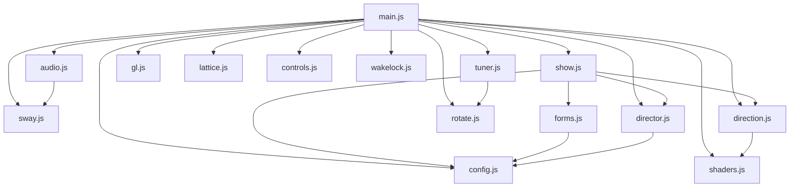

`config.js` reads `innerWidth` (to choose smaller defaults on a small
screen), so Node scripts that import it set `globalThis.innerWidth` first
(see `tools/story-stats.mjs`).

## 10. Testing and tools

Details and commands are in [development.md](development.md).

- **`test/smoke.mjs`** serves the repository and opens it in headless Chrome
  (software GL) over the DevTools protocol. It fails on any error, on a
  shown fallback, on a frame loop that stalls, or on a black canvas. It
  visits the default page (with a click, the keys, turning the picture, a
  scene change without a reload, and Reset), every colour mode, both panels
  (`lab.html#tune` and `#tune`: the GitHub link and the commit link from a
  fake `version.json`, the sliders' `touch-action`, which settings each
  shows, the link to the other page, and the shared saved settings that
  the viewer page's Reset clears), the rain scene in the lab and the
  crystal scene (with the same click, keys and Reset), a seeded time with and without the story, four of the forms
  held, and `?jitter=pitch`. It then renders the sound: a held orb must be
  audible, a still room at least 3 dB quieter, and neither may clip. The
  `test` workflow runs it on every pull request and push to main.
- **`test/render-audio.mjs`** renders the page's real sound for a seed and a
  stretch of the show, to a WAV file plus the show's state every 0.05 s.
  The page runs on a fake clock, with an `OfflineAudioContext` in place of
  its `AudioContext`. There is no hook in the page's code.
- **`tools/capture-frames.mjs`** captures PNG frames of the scenes in
  `tools/scenes.json` on a fake clock with a seeded `Math.random`.
  **`tools/make-gifs.py`** turns them into the looping GIFs in `docs/`.
- **`tools/doc-shots.mjs`** captures the stills listed in
  `tools/doc-shots.json` the same way, and **`tools/doc-images.py`** puts
  them together into the labelled pictures in `docs/img/`. Both capture
  tools open the page through **`tools/page.mjs`** (the server, Chrome and
  the fake clock).
- **`tools/story-stats.mjs`** measures the colour story in Node, without
  rendering: over many seeds, how often neighbouring passages differ in
  hue, how often each mode and palette comes, how long one colour family
  holds, and how much of the rain flows sideways.

## 11. Decisions and trade-offs

**Light adds up; nothing hides anything.** The LEDs and wires are drawn
with additive blending and no depth buffer, so near strands never stand dark
in front of a form. The rays add to them too; among themselves they share a
budget, so crowded bright points keep a soft sparkle instead of a sheet. The strands are fine threads, so additive light reads
right.

**Points, not a full-screen effect.** The picture is made of real points,
one per LED, each of the same physical size. A form is not drawn as a shape:
it only decides how bright the LEDs inside it are. So a form always looks
like part of the lattice, and the lattice density sets how fine it is.
The glow and the haze are the only blur, and they take only light past a
knee, so the dark between the points stays black.

**Every LED's light in the vertex shader.** An LED has one colour per frame.
Working it out in the vertex shader does it once per LED, not once per pixel
of its sprite. The fragment shaders only spread that colour. The costs are
held down by skipping early: LEDs out of view or in the fog, LEDs far from a
form, strands without rain, and LEDs whose light is nearly nothing. Wire
strips use the restart index for the same reason. The cost is that the
shader runs for every LED of every pass, visible or not: about a million
on a desktop by default, and nine times that with wall mirrors ("Each copy
draws the lattice again: costly", says the setting's hint).

**The LEDs as far apart up and down as across.** A form is a shape in space,
and the lattice draws it only as finely as its coarsest spacing. Strands
much farther apart than the LEDs on them draw a form as a row of vertical
bars, and a thin ring or veil breaks into separate strands. So the number
of LEDs is set in all (`leds`), and the strands and rows follow at an equal
spacing (`aspect` 1). The cost is fewer LEDs on each strand: a drop's trail
crosses fewer of them, and its head steps from one to the next less often.

**The light is set per volume, not per LED.** A denser lattice would
otherwise be brighter, and its rain a haze: every strand carrying drops. So
the light per LED goes down as the LEDs get closer, and the rain falls on as
many strands per area as on the lattice the light is set for. A sparser
lattice keeps each LED's light rather than making its few LEDs glare.

**Only the falling rain fades as in a real room.** The falling rain's light
falls off with distance more steeply than the rest, and the floor mirrors it
less straight down. That gives the falling rain its depth: without it,
thousands of equal far strands fill the view as evenly as a pattern. The
forms keep the plain fog: each is one subject at one place, and they would
only dim. The sideways rain keeps it too: its flow across the strands
already shows the depth.

**Mirrors are the same LEDs again.** The images are computed at the LED
itself and only drawn elsewhere. A reflection is always exact, and costs one
more pass, not a different renderer.

**Nothing comes or goes at once.** Many details exist only to avoid a one-frame
step: the rain share fades per strand, LEDs fade near the eye, a drop fades
in over its first LEDs, a wave swells in, a form's LEDs fade as they rise
away. The noise's hash (`hash3`) uses no sine: a hash built on a sine jumps
all at once every few seconds.

**Two colour looks, not a blend.** Blending two colour modes passes through
grey. So a new colour takes the rain over strand by strand.

**A rain never turns.** The direction belongs to the passage, and changes
only between rains. A rain that turned while it fell would show both
directions at once.

**Exact wraps for long sessions.** The falling time wraps at 1000, and every
drop's rate is rounded to fit it, so the wrap never shows.

**Seeds, with limits.** The show, the tracks and the places of the
automatic ripples are seeded, so a link with `?seed=` and `?t=` shows one
passage. The strands (places, seeds, ranks), the 1/f sways and the music
use `Math.random`. The tools seed `Math.random`
inside the page when they need an exact repeat.

**No build, by hand.** With no bundler, the service worker cannot know the
files; `sw.js: CORE` is a list kept by hand, and network-first caching avoids
any version to bump.
