# Settings guide

This guide shows what each setting changes, with a picture where it can be
seen. It also lists the keys and the URL parameters.

- [Words used here](#words-used-here)
- [Controls](#controls): buttons, panels, keys, URL parameters
- Settings, in the lab panel's order: [Scene](#scene), [Display](#display),
  [Density](#density), [LED](#led), [Light](#light), [Rain](#rain),
  [Colour](#colour), [Camera](#camera), [Ripples](#ripples),
  [Meditation](#meditation), [Sound](#sound)
- [Not shown in pictures](#not-shown-in-pictures)

In the tables below, a name in **bold** is also in the viewer page's
panel; the other settings are only in the lab (see
[The settings panels](#the-settings-panels)).

How a design works inside is in [design.md](design.md).

## How to read the pictures

Each picture comes from the real page, on a fixed clock, with one setting
changed at a time. The label in a picture is the setting that made it.

Under each figure is the URL query it was made with. Every query also
starts with a common part, left out below:

```
?dpr=1&quality=full&ripples=0&breath=off&seed=1
```

So the first cell of the forms figure is
`index.html?dpr=1&quality=full&ripples=0&breath=off&seed=1&scene=crystal&layer=off&t=30&form=orb`.
Where a figure's part and a cell's part name the same key, the cell's wins.

On the live page the same URL shows the same scene, colours and forms. It
does not show the same pixels: the places of the LEDs are random on each
load, and the frame times differ. `tools/doc-shots.mjs` makes these
pictures again (see [development.md](development.md#the-pictures-of-the-docs)).

## Words used here

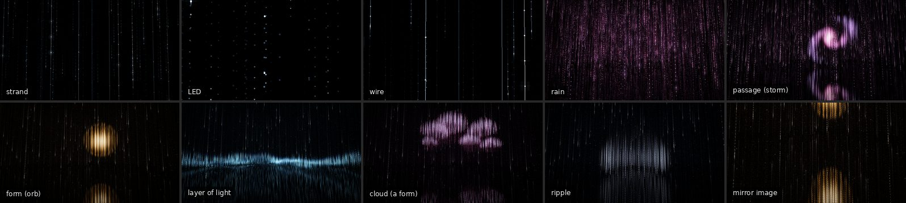

| Word | What it is |
| --- | --- |
| **strand** | A vertical line of LEDs hanging from the ceiling. The room is a square lattice of strands. Their feet stop a little above the floor. |
| **LED** | One point of light on a strand. Every point you see is an LED, lit or at rest. |
| **wire** | The thin line between two LEDs of a strand. It glows faintly with their light (Wire glow). |
| **rain** | Light that runs down the strands, drop after drop: a bright head and a fading trail. |
| **passage** | One stretch of the show: rain, a form, rain through a form (storm), a still room, or sideways rain (drift). Each lasts from about 20 seconds to over a minute. |
| **form** | A large shape of light that gathers in the room: an orb, a spiral, a cloud, a ring or a veil. |
| **layer of light** | A sea of light near the floor. It comes and goes beside the forms. |
| **cloud** | The form made of separate points: round heads over a flat base. (The colour mode `cloud` is something else: drifting clouds of colour in the rain.) |
| **ripple** | A wave of light from a click or a tap, or from the show itself. It also rings a bell. |
| **mirror image** | The room seen again, upside down, in the dark mirror floor. A thin dark line parts each strand from its image. |

Queries, left to right, top row first:
`scene=rain&weather=drizzle&color=mono&palette=ice&flow=down&t=30&fov=30&radius=16&grid=24&rows=48`
with `wire=1&rest=0.1` (strand), `wire=0&rest=0.1&size=0.03` (LED, cut out),
`wire=2` (wire, cut out); `scene=rain&flow=down&t=30` (rain);
`t=60` (a storm passage of the whole show);
`scene=crystal&form=orb&layer=off&t=30` (form);
`scene=crystal&form=none&layer=on&t=30` (layer);
`scene=crystal&form=cloud&layer=off&t=30` (cloud);
`scene=crystal&form=none&layer=off&t=30` and a click (ripple);
`scene=crystal&form=orb&layer=off&t=30&mirror=1` (mirror image, lower half).

## Controls

### Buttons

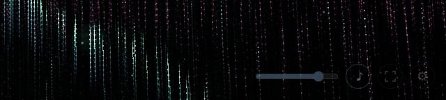

At the bottom right, from the left: the volume bar, sound on and off (♪),
full screen, and the settings panel (⚙). On a touch screen a fifth button,
a phone with an arrow, turns the picture between landscape and portrait.
The buttons and the cursor hide after a few still seconds; a move, a tap
or a key brings them back. The screen stays awake while the page is
showing, where the browser allows it.

The rotate button (or `r`) shows the picture in the other shape, also when
the phone's rotation lock is on. Where the browser can lock the orientation
(Android Chrome, in full screen or as an installed app), it does that.
Where it cannot (iPhone and iPad Safari, desktop), the page turns its own
picture a quarter, so turn the phone to match. Pressing again goes back;
really turning the phone also ends it.

Query: `t=110`, with the page's buttons shown and a key pressed (cut out).

### The settings panels

The site has two pages, with the same picture, keys and URL parameters:

- **The viewer page** (`index.html`, the address of the site) has a small
  panel: Scene, Colour mode, Brightness (the Exposure setting), Quality,
  and the levels of the sound (Pad, Bells, Rain, Forms). The volume is the
  bar by the buttons. Its link **All settings** opens the lab.
- **The lab** (`lab.html`) has every setting in its panel, in groups. Its
  link **Fewer settings** opens the viewer page.

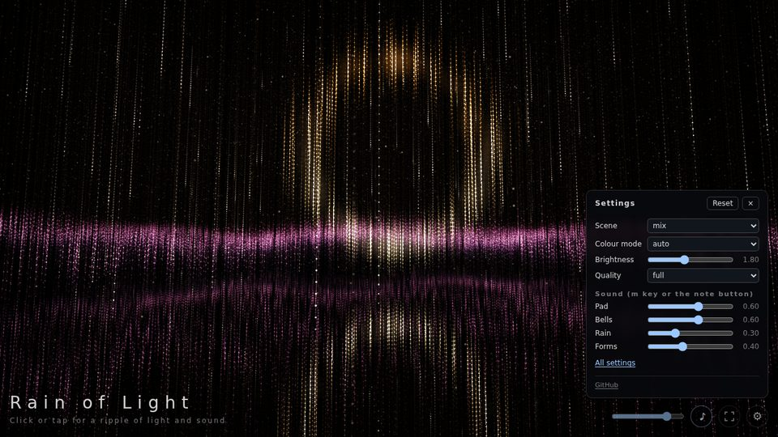

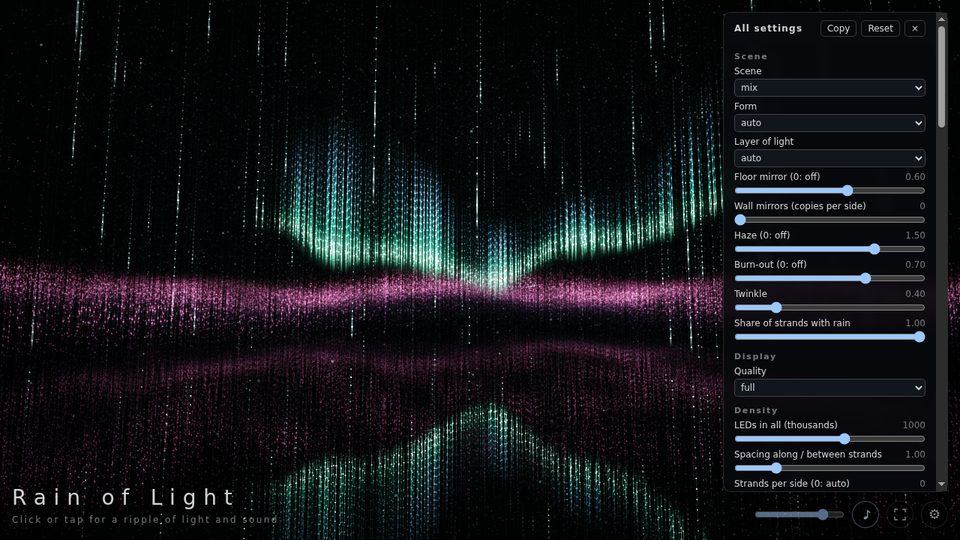

The gear button or the `p` key opens the panel; a link that ends in
`#tune` opens the page with it (`lab.html#tune`: the lab with its panel
open). A link to the other page keeps the URL query, and opens its panel.
A change shows at once, without a reload.

- Both pages keep what you change in this browser, in one set of saved
  settings: a setting changed in the lab also holds on the viewer page,
  where the panel does not show it.
- **Reset** brings back every default, also on the viewer page: there it
  also resets the settings that only the lab shows.
- **Copy** (in the lab) copies the settings as JSON.
- On a touch screen the panel scrolls with a finger anywhere, also over a
  slider: a slider moves only when you drag it sideways, and a tap on it
  does nothing. In portrait the panel is a sheet over the lower part, so the
  picture stays in view. On a phone held sideways, the viewer page's panel
  puts the sound beside the other settings.
- The bottom of the panel links to the repository and names the commit
  being served (see [development.md](development.md#version)).

Query: `t=110`, with the page's buttons shown and `p` pressed, on
`index.html` and on `lab.html`.

### Pointer and keys

- **Click or tap**: a ripple of light, and a bell.
- **Drag**: look around; the picture follows the mouse or the finger. On a
  touch screen a short tap that hardly moves rings a ripple; a longer touch
  or a move looks around.

| Key | Does |
| --- | --- |
| `p` | settings panel |
| `c` | next colour, of the rain and of the forms |
| `w` | next weather |
| `d` | switch the rain's direction (falling / sideways), and hold it |
| `v` | next camera move |
| `m` | sound on / off |
| `f` | full screen |
| `r` | landscape / portrait |

The keys are the same on both pages. `c`, `w` and `v` work on the Colour
mode, Weather and Move settings. While
a setting is `auto`, the key moves the show on to its next choice. Otherwise
it sets the next value in the list. `d` sets Direction to `down` or `across`.

### URL parameters

Every setting below can be given in the URL with its key, such as
`?color=cloud&weather=drizzle`. A URL value wins over a saved one. A value
that does not exist falls back to the default; a number is kept within the
slider's range. Both pages take every parameter. The URL also takes four
things that are not in the panel:

| Parameter | Values | Default | Does |
| --- | --- | --- | --- |
| `seed` | any number | random | One order of the show: its passages, forms, weather, colours, direction and density. The same seed gives the same show. |
| `t` | seconds | `0` | Starts the show at that time of its order. The camera starts there too, so a time shows one view. |
| `dpr` | a number, such as `1` or `1.5` | `2` | The highest pixel ratio drawn. A screen with a higher ratio is drawn at this one. |
| `#tune` | (a hash, not a parameter) | | Opens the settings panel: `#tune` the viewer page's, `lab.html#tune` the lab's. |

## Scene

| Panel | URL key | Values | Default | What you see |
| --- | --- | --- | --- | --- |
| **Scene** | `scene` | `mix`, `rain`, `crystal` | `mix` | `mix`: the whole show, rain and forms come and go and blend. `rain`: only the rain, which never ends. `crystal`: only the forms of light. |
| Form | `form` | `auto`, `orb`, `spiral`, `cloud`, `ring`, `veil`, `none` | `auto` | `auto`: as the scene brings them. A name holds that form for good. `none`: no form. |
| Layer of light | `layer` | `auto`, `on`, `off` | `auto` | `auto`: the layer comes and goes with the show (about 70% of the time). `on` holds it, `off` removes it. |
| Floor mirror (0: off) | `mirror` | 0 to 1 | `0.6` | How bright the image in the floor is. |
| Wall mirrors (copies per side) | `walls` | 0 or 1 | `0` | `1`: the room repeats beyond its walls, one copy on each side. Each copy draws the lattice again, so it is costly. |
| Haze (0: off) | `haze` | 0 to 2 | `1.5` | A wide, soft glow around the brightest light. |
| Burn-out (0: off) | `burn` | 0 to 1 | `0.7` | The brightest light loses its colour and burns out to white. |
| Twinkle | `twinkle` | 0 to 2 | `0.4` | In a still room, one LED in five flashes now and then. It fades out as a rain passage comes. |
| Share of strands with rain | `rainShare` | 0 to 1 | `1` | The share of strands that carry rain. |

### Scenes

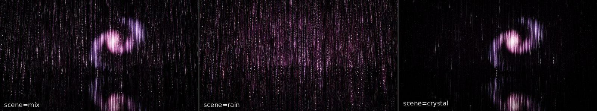

Query: `t=60` with `scene=mix`, `scene=rain`, `scene=crystal`. At this time
of seed 1 the whole show has a storm passage: rain falls through a spiral.

The whole show moves between five kinds of passage:

- **rain**: rain of light, with its image in the floor. Its light fades
  with distance as in a real room: near strands stand out bright, far ones
  fade into a mist, and the floor's image is fainter right below you than
  towards the far end.
- **form**: the rain stops, and a form glows in the still room, with a few
  pale drops and a sparse twinkle.
- **storm**: the rain falls through a form. The rain takes the form's
  colours, thins, and gives way around it; drops that pass through take its
  colour.
- **still**: only the layer of light, and a few pale drops.
- **drift**: rain that flows sideways, each time a new way. It comes only
  between two form passages. See [Direction](#direction).

A form that comes or goes while rain falls (not sideways) does so from the
top down, as if rain gathered into it or ran off it as rain.

### Forms

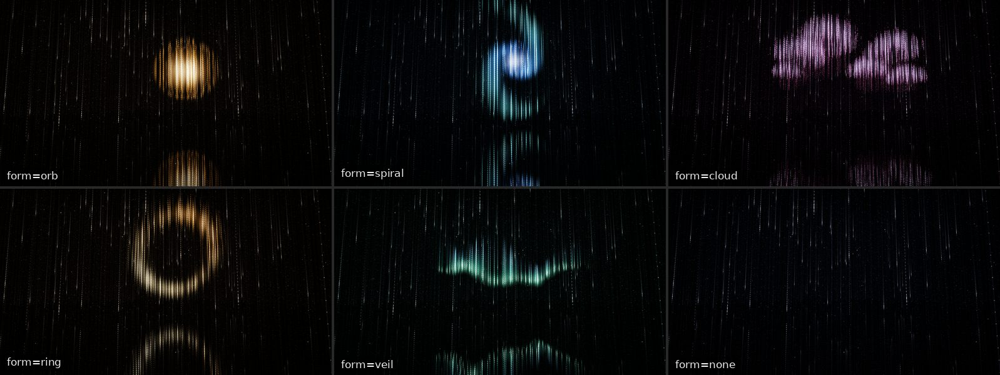

Query: `scene=crystal&layer=off&t=30` with `form=orb`, `form=spiral`,
`form=cloud`, `form=ring`, `form=veil`, `form=none`.

Each form moves slowly in its own way, and the floor shows each move:

- **orb**: rises out of the floor, meeting its image there; drifts and
  breathes. Now and then it parts into two that drift apart and flow
  together again. It goes by sinking back into the floor. It is pale at
  its heart and deepens to its rim.
- **spiral**: unfurls out of its bright core, its arms turning, and winds
  back into it as it goes. It turns its face to the room, leaning to and fro.
- **cloud**: separate points, round heads of several heights over a flat
  base, lit from above. It gathers as points fall into place, drifts across
  the room, now and then parts in two, and goes by rising away as points.
- **ring**: rises out of the floor lying flat, then stands up and turns
  slowly. Now and then it parts into two hoops that cross and come back
  into one. It goes by lying down and sinking into the floor.
- **veil**: a curtain of light like an aurora, across the room, a little
  beyond its middle. It unrolls from one end, its folds travelling along it; its lower
  hem is a bright line that rises and falls, with rays of many heights
  above it. It goes by lifting away upward.

Each form takes its colours from a few palettes of its own
(`config.js: FORMS`). The forms keep a little beyond the middle of the room
as you look at them.

### Layer of light

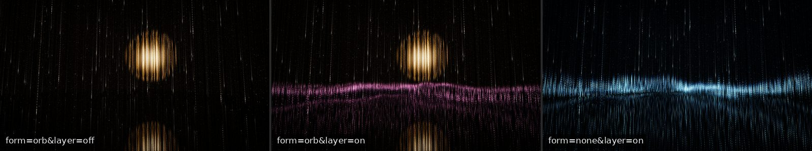

Query: `scene=crystal&t=30` with `form=orb&layer=off`, `form=orb&layer=on`,
`form=none&layer=on`.

The layer is a sea of light near the floor. Each time it comes, it has a
height, a thickness and a brightness of its own.

- Under a form it thins out, so the form stays the subject. Its colour
  answers the form above it (blue under amber, blue or pink under green, and so on).
- A pale form (ice, candle) sets the room and its rain in a deeper colour.
- With the room to itself it is the subject: a brighter sea in a longer
  swell, its crests paler.

### Floor mirror

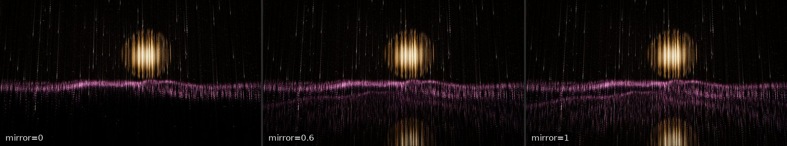

Query: `scene=crystal&form=orb&layer=on&t=30` with `mirror=0`, `mirror=0.6`,
`mirror=1`.

The strands hang a little above the mirror floor, so a thin dark line runs
between each strand and its image. Light that runs down a strand runs up
its image, towards that line. The image fades with height, as on dark glass.

### Wall mirrors

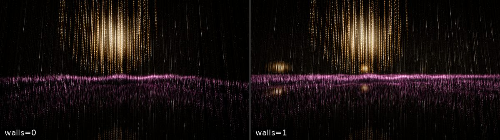

Query: `scene=crystal&form=orb&layer=on&t=30&camera=spin&radius=16&fov=100&fog=40`
with `walls=0`, `walls=1`. The wide view and the far visible distance let
the copies beyond the walls show.

### Twinkle

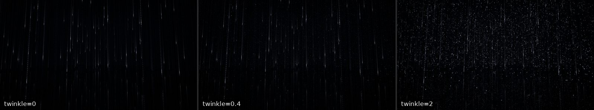

Query: `scene=crystal&form=none&layer=off&t=30` with `twinkle=0`,
`twinkle=0.4`, `twinkle=2`. Twinkle belongs to the still room: it fades
out as a rain passage comes.

### Share of strands with rain

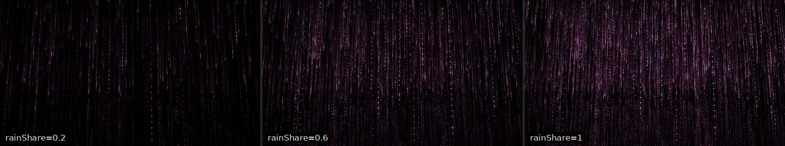

Query: `scene=rain&flow=down&t=30` with `rainShare=0.2`, `rainShare=0.6`,
`rainShare=1`. While rain falls through a form, the share is lowered by
about a third, so the form shows.

## Display

| Panel | URL key | Values | Default | What you see |
| --- | --- | --- | --- | --- |
| **Quality** | `quality` | `auto`, `full` | `auto` | `auto`: if frames are slow, the picture is drawn at a lower resolution (down to half), and raised again when the device keeps up. `full`: always as sharp as the screen allows (up to `?dpr=`). |

No picture: a fast machine draws both the same.

## Density

| Panel | URL key | Values | Default | What you see |
| --- | --- | --- | --- | --- |
| Strands per side (max) | `grid` | 8 to 160 | `72` (`44` on a small screen) | How many strands stand along each side of the room. |
| LEDs per strand (max) | `rows` | 8 to 256 | `96` (`72` on a small screen) | How many LEDs hang on each strand. |
| Layout | `layout` | `strands`, `scatter`, `grid` | `strands` | `strands`: LEDs in lines along each strand. `scatter`: at random within one strand's width. `grid`: a regular lattice. |
| LED spacing | `jitter` | `off` (even), `0.25` (a little uneven), `0.5` (uneven), `pitch` (per strand), `cluster` (clustered) | `off` | How the LEDs sit along each strand. `0.25` and `0.5` move each LED by up to that share of the gap. `pitch` gives each strand its own even gap. `cluster` gathers them in bunches and gaps. With Layout `strands` only. |
| Density change | `density` | `auto`, `manual` | `auto` | `auto`: the share of strands and LEDs that show drifts slowly between the lower limits below and full. `manual`: held at the two shares below. |
| Share of strands (manual) | `strandShare` | 0.02 to 1 | `1` | With `manual`: the share of strands shown. |
| Share of LEDs (manual) | `rowShare` | 0.02 to 1 | `1` | With `manual`: the share of LEDs shown on each strand. |
| Lowest share of strands (auto) | `strandMin` | 0.02 to 1 | `0.66` | With `auto`: the lowest share of strands it drifts to. |
| Lowest share of LEDs (auto) | `rowMin` | 0.02 to 1 | `0.68` | With `auto`: the lowest share of LEDs it drifts to. |

A small screen is one whose shorter side is under 700 CSS pixels. The two
maximums are what the room is built with; the shares then thin it out.

### Strands per side

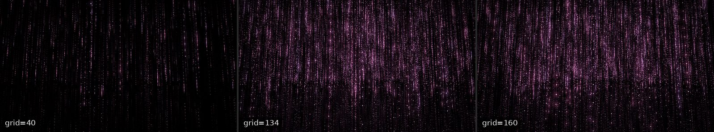

Query: `scene=rain&flow=down&t=30` with `grid=24`, `grid=72`, `grid=140`.

### LEDs per strand

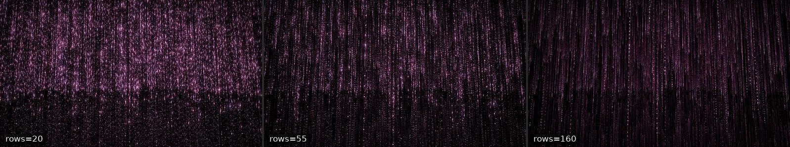

Query: `scene=rain&flow=down&t=30` with `rows=24`, `rows=96`, `rows=220`.

### Layout

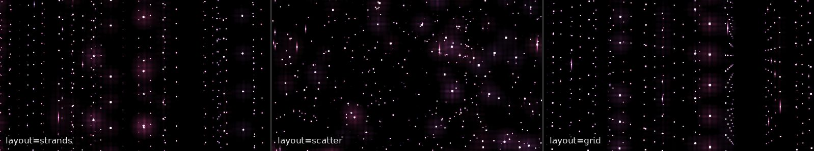

Query (close view, centre cut out):
`scene=rain&flow=down&weather=downpour&trail=4&t=30&fov=30&radius=16&grid=24&rows=48&wire=0&exposure=3`
with `layout=strands`, `layout=scatter`, `layout=grid`.

### LED spacing

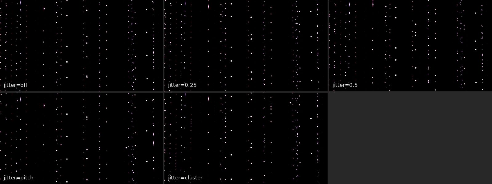

Query (close view, centre cut out): as for Layout, with `jitter=off`,
`jitter=0.25`, `jitter=0.5`, `jitter=pitch`, `jitter=cluster`.

### Density change

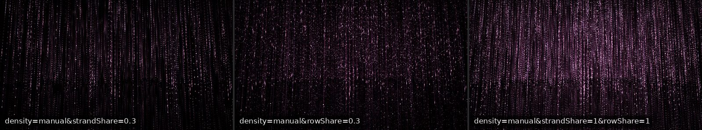

Query: `scene=rain&flow=down&t=30` with `density=manual&strandShare=0.3`,
`density=manual&rowShare=0.3`, `density=manual&strandShare=1&rowShare=1`.

## LED

| Panel | URL key | Values | Default | What you see |
| --- | --- | --- | --- | --- |
| LED size | `size` | 0.004 to 0.05 | `0.018` | How large each LED is, in the room's units. |
| Largest size (px) | `maxPx` | 1.5 to 16 | `4.5` | The largest an LED is drawn, in pixels, however near it is. |
| Brightness at rest | `rest` | 0 to 0.3 | `0.03` | How bright an unlit LED glows: the faint lattice of the room. |
| Wire glow (0: off) | `wire` | 0 to 2 | `0.2` | The wires between the LEDs glow with their light. |

### LED size and largest size

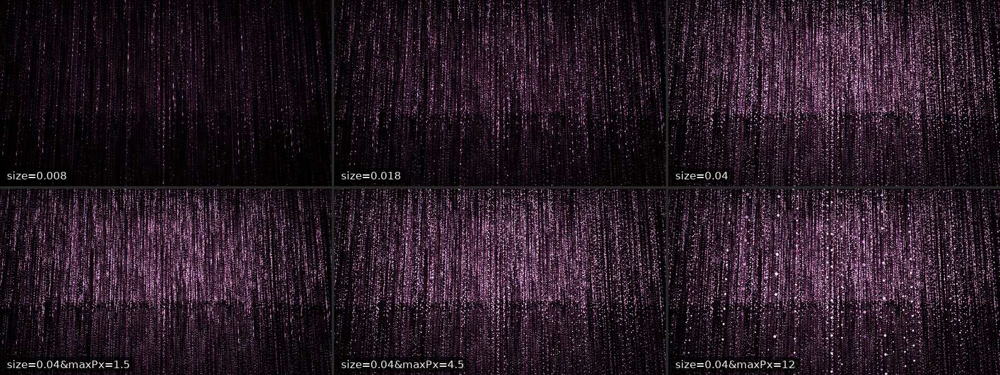

Query: `scene=rain&flow=down&t=30` with `size=0.008`, `size=0.018`,
`size=0.04`; then `size=0.04` with `maxPx=1.5`, `maxPx=4.5`, `maxPx=12`.

### Brightness at rest

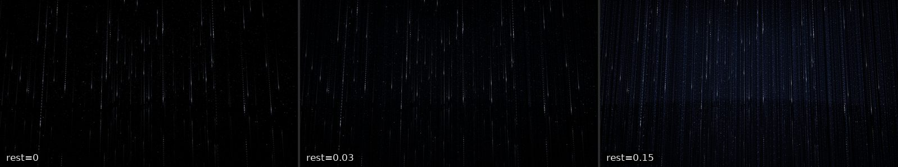

Query: `scene=crystal&form=none&layer=off&t=30` with `rest=0`, `rest=0.03`,
`rest=0.15`.

### Wire glow

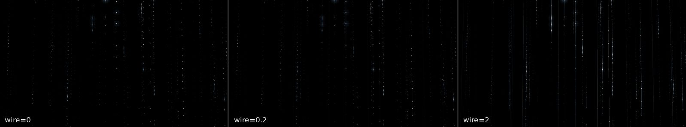

Query (close view):
`scene=rain&weather=rain&color=mono&palette=ice&flow=down&t=30&fov=30&radius=16&grid=24&rows=48`
with `wire=0`, `wire=0.2`, `wire=2`.

## Light

| Panel | URL key | Values | Default | What you see |
| --- | --- | --- | --- | --- |
| Trail brightness | `rainGain` | 0 to 12 | `4` | How bright the trail behind each drop is. |
| Head brightness | `tipGain` | 0 to 15 | `5` | How bright the head of each drop is. |
| **Exposure** (viewer page: Brightness) | `exposure` | 0.2 to 4 | `1.8` | The brightness of the whole picture. |
| Glow | `bloom` | 0 to 2 | `0.8` | The soft glow around bright light. |
| Visible distance | `fog` | 6 to 40 | `34` | How far into the room you see before light fades out. While rain falls, the room closes in a little, and the falling rain's light fades all along the way. |
| Light rays | `rays` | `off`, `2`, `4`, `6`, `8` | `2` | Star-like rays from every bright point: drop heads, forms, the layer, waves and twinkles. `2` is up and down only. |
| Ray length (px at 1080 tall, bright point) | `rayLength` | 2 to 60 | `20` | How long the rays of a bright point are. A ray grows with its point's light: a dimmer or farther point casts a shorter ray, down to none. It scales with the view, like the LEDs and their spacing. |
| Black floor (/255, 0: off) | `blackFloor` | 0 to 16 | `3` | Glow fainter than this is dropped, so the space between the points is true black (most visible on OLED screens). |

### Trail and head brightness

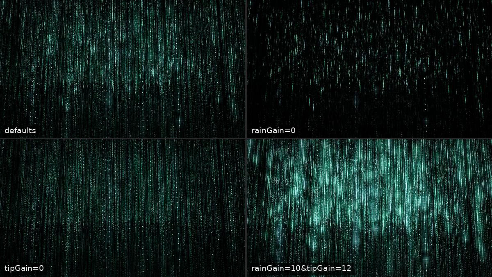

Query: `scene=rain&flow=down&t=30&color=mono&palette=aurora` with
`rainGain=4&tipGain=5` (the defaults), `rainGain=0`, `tipGain=0`,
`rainGain=10&tipGain=12`.

### Exposure

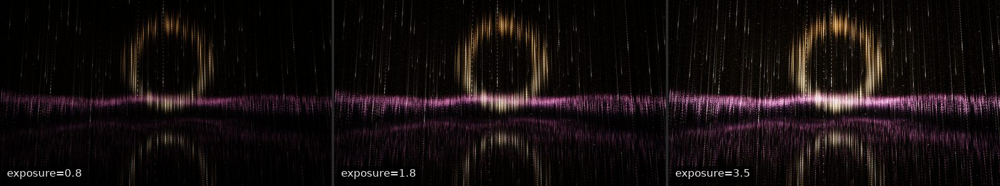

Query: `t=110` (a ring passage of the whole show) with `exposure=0.8`,
`exposure=1.8`, `exposure=3.5`.

### Glow

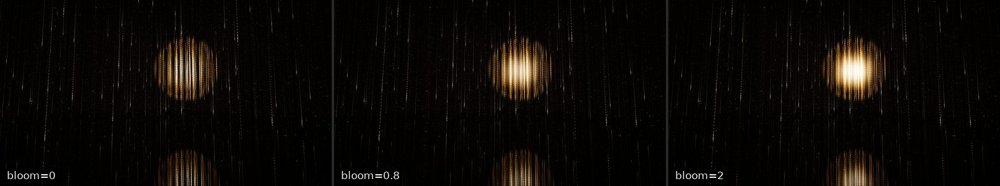

Query: `scene=crystal&form=orb&layer=off&t=30` with `bloom=0`, `bloom=0.8`,
`bloom=2`.

### Visible distance

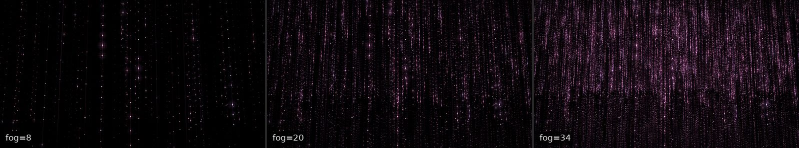

Query: `scene=rain&flow=down&t=30` with `fog=8`, `fog=20`, `fog=34`.

### Light rays

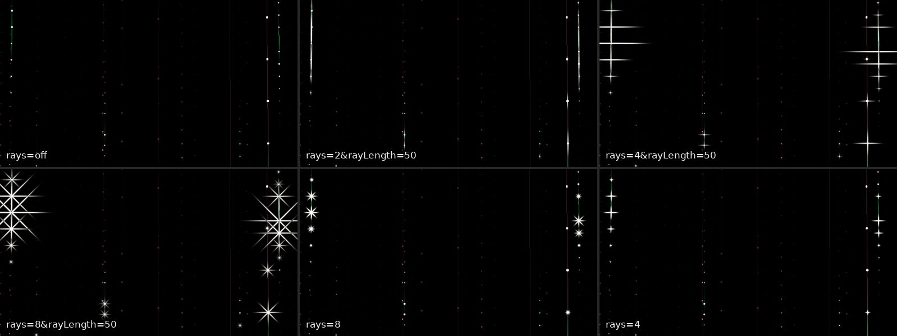

Query (close view, centre cut out):
`scene=rain&flow=down&color=comet&weather=drizzle&t=30&fov=30&radius=16&grid=24&rows=48&tipGain=12`
with `rays=off`; `rays=2`, `rays=4`, `rays=8`, each with `rayLength=50`;
`rays=8` and `rays=4` (default length).

A ray's length follows its point's light: the Ray length is the length for
a bright point, and a point half as bright casts a ray half as long. So far
heads, dimmed by distance, cast short rays, and a ray grows in and out with
its light. Forms, the layer, waves and twinkles cast rays by the same rule.
Where many bright points stand close together, as in a form, their rays
share a limit of light, so the form keeps its points with a soft sparkle.

## Rain

| Panel | URL key | Values | Default | What you see |
| --- | --- | --- | --- | --- |
| Weather | `weather` | `auto`, `drizzle`, `rain`, `shower`, `downpour` | `auto` | How fast the drops fall and how many join. `auto` moves between drizzle and rain on its own; the heavy ones, `shower` and `downpour`, come only when chosen. The weather also sets how many pale drops fall in a still room. |
| Speed (x) | `speed` | 0 to 4 | `1` | How fast the rain runs; `0` stops it. |
| Trail length (x) | `trail` | 0.2 to 4 | `1` | How long the trail behind each head is. |
| Direction | `flow` | `auto`, `down`, `across` | `auto` | `auto`: as the passage has it; now and then a drift passage flows sideways. `down`: always from above. `across`: always sideways. |

The rain also swells and eases within its weather, slowly and never at one
pace.

### Weather

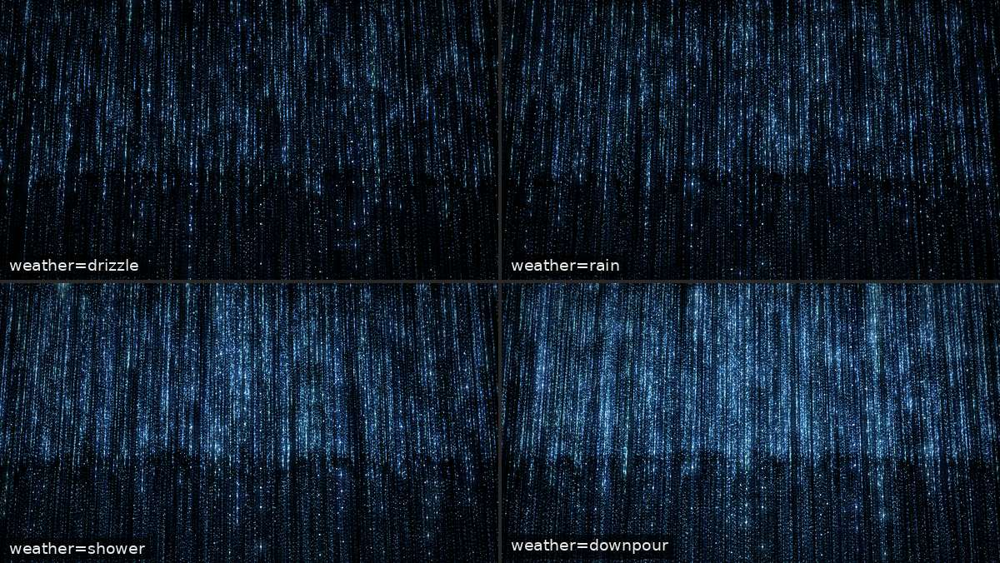

Query: `scene=rain&flow=down&t=30&color=mono&palette=deep+sea` with
`weather=drizzle`, `weather=rain`, `weather=shower`, `weather=downpour`.

### Trail length

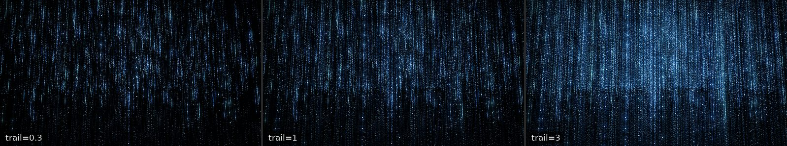

Query: `scene=rain&flow=down&t=30&color=mono&palette=deep+sea` with
`trail=0.3`, `trail=1`, `trail=3`.

### Direction

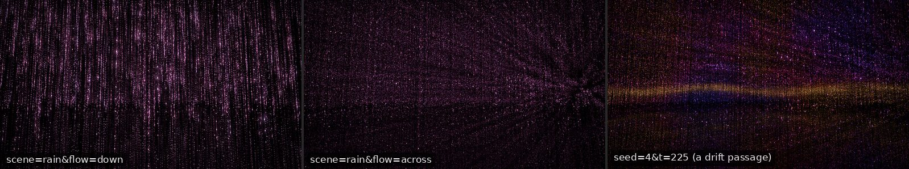

Query: `t=30` with `scene=rain&flow=down`, `scene=rain&flow=across`; and
`seed=4&t=225`, a drift passage of the whole show.

- In the whole show, about one rain passage in seven is a drift (a passage
  of half a minute or so), always between two form passages. A rain keeps
  its direction for its whole life, and falling and sideways rain never
  show at once.
- The few pale drops of a still room fall, and flow sideways only around a
  drift passage.
- With `d` or the Direction setting, the drops of the old direction stop
  coming and fade out; only then do the new ones set out.
- `scene=rain` never ends, so it keeps falling unless Direction says
  otherwise.

## Colour

| Panel | URL key | Values | Default | What you see |
| --- | --- | --- | --- | --- |
| **Colour mode** | `color` | `auto` and the 11 modes below | `auto` | How the rain is coloured. `auto` moves between them on its own. |
| Colour story | `story` | `on`, `off` | `on` | `on`: the colours of the rain and the forms drift slowly together, from cool to warm and back. `off`: each is chosen on its own. |
| Rainbow style | `rainbow` | `drop`, `led`, `bands` | `drop` | For the `rainbow` mode: a random hue per drop, per LED, or flowing bands. |
| Palette | `palette` | `auto`, `ice`, `amber`, `sakura`, `aurora`, `deep sea`, `candle` | `auto` | The palette the rain uses, in the modes that use one (such as `mono`, `gradient`, `comet`, `accent`). |
| Band speed | `bandSpeed` | 0 to 0.8 | `0.17` | How fast the colour bands of `gradient` and of rainbow `bands` slide. |
| Band scale | `bandScale` | 0.1 to 4 | `1` | How many bands fit in the room: higher is narrower. |
| Saturation (rainbow) | `saturation` | 0 to 1 | `1` | How strong the rainbow's colours are. |
| Colour set (palette) | `set` | `auto`, `pastel`, `neon`, `wa`, `sunset`, `ocean` | `auto` | For the `palette` mode: the set of four colours the drops pick from. |
| Length of a day (s, sky) | `skyDay` | 20 to 600 | `90` | For the `sky` mode: seconds for dawn, day, dusk and night to go by. |

`c` turns both the rain's colours and the forms' colours. A new colour takes
the rain over strand by strand, from the top down, so two colours never
blend into grey.

### Colour modes

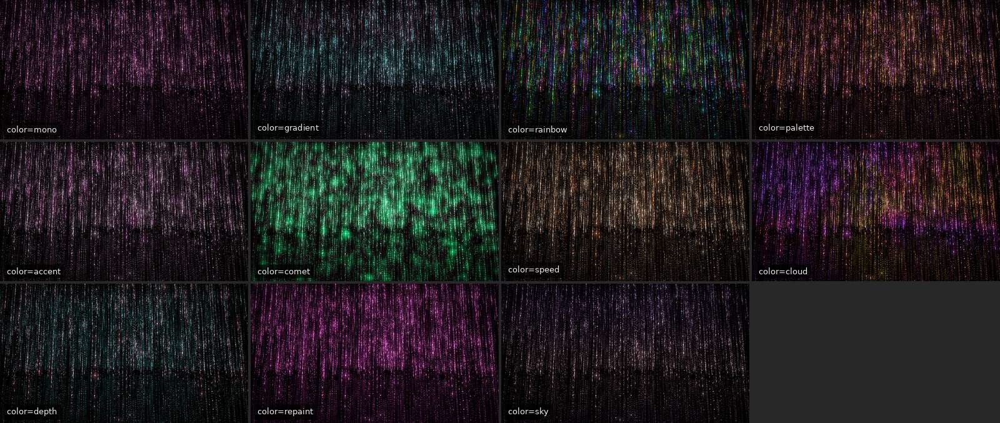

Query: `scene=rain&flow=down&t=30&weather=rain` with `color=` each mode.
The palette and the set are as seed 1 has them at that time.

| Mode | What you see |
| --- | --- |
| `mono` | one palette |
| `gradient` | two palettes, in a flowing gradient |
| `rainbow` | a random hue per drop (see Rainbow style) |
| `palette` | each drop picks from a set of colours (see Colour set) |
| `accent` | pale rain, now and then a coloured drop |
| `comet` | white heads, coloured trails |
| `speed` | colour by speed: slow drops warm, fast ones blue-white |
| `cloud` | drifting clouds of colour |
| `depth` | one colour near, another far |
| `repaint` | each wave paints the field anew (and ripples come more often) |
| `sky` | dawn, day, dusk and night go by |

### Colour story

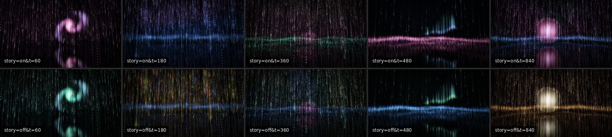

Query: `seed=1` with `story=on` (top) and `story=off` (bottom), at
`t=60`, `t=180`, `t=360`, `t=480`, `t=840`.

The colours tell one slow story: a mood, a hue that wanders from green
through blue, violet and pink to amber and back.

- It moves from one palette's colour to the next in two to three minutes,
  never at one pace, taking some 4 to 6 minutes from blue to amber.
- The rain's colours, each form's and the layer's lean towards it, so one
  passage's colours belong with the next's.
- No one colour holds the room for long: once the forms have kept one
  colour for a minute and a half, the next form most likely takes another.
- About one choice in five is free of the mood. Rain of many colours
  (rainbow, speed, depth, repaint, sky) still comes, less often.
- `story=off` gives each its own colour, as the seed alone has it.

### Rainbow style

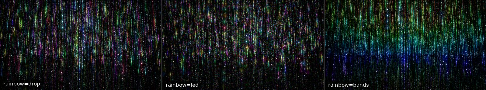

Query: `scene=rain&flow=down&t=30&color=rainbow` with `rainbow=drop`,
`rainbow=led`, `rainbow=bands`.

### Palette

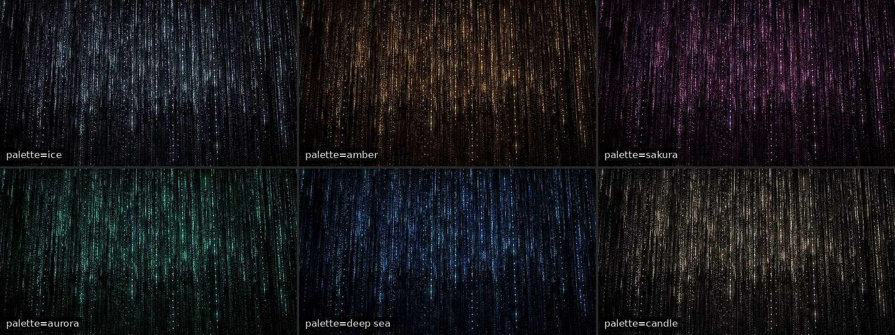

Query: `scene=rain&flow=down&t=30&color=mono` with `palette=` `ice`,
`amber`, `sakura`, `aurora`, `deep+sea`, `candle`.

### Band scale

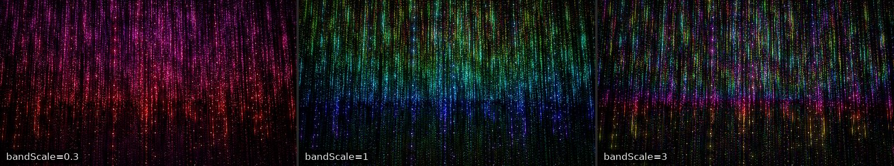

Query: `scene=rain&flow=down&t=30&color=rainbow&rainbow=bands` with
`bandScale=0.3`, `bandScale=1`, `bandScale=3`.

### Saturation

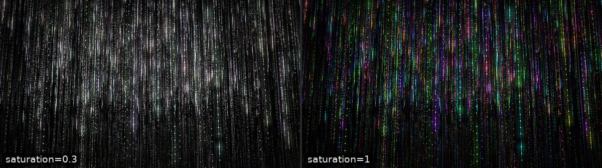

Query: `scene=rain&flow=down&t=30&color=rainbow` with `saturation=0.3`,
`saturation=1`.

### Colour set

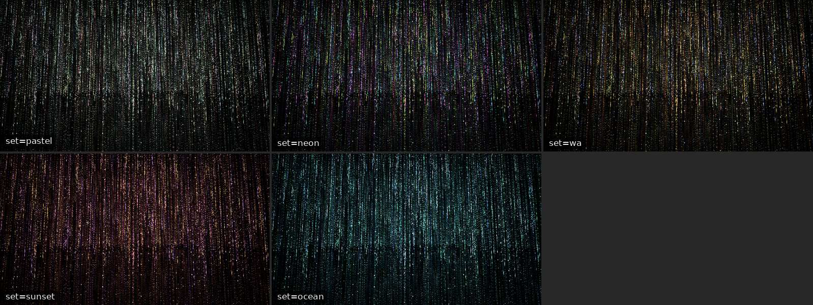

Query: `scene=rain&flow=down&t=30&color=palette` with `set=` `pastel`,
`neon`, `wa`, `sunset`, `ocean`.

### Length of a day

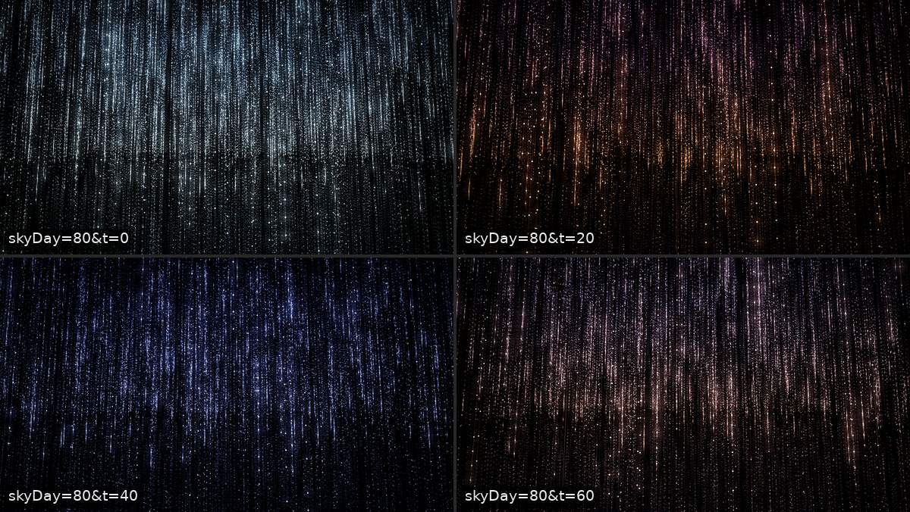

Query: `scene=rain&flow=down&color=sky&skyDay=80` at `t=0`, `t=20`, `t=40`,
`t=60`. Where in the day the show starts comes from the seed.

## Camera

| Panel | URL key | Values | Default | What you see |
| --- | --- | --- | --- | --- |
| Move | `camera` | `auto`, `orbit`, `walk`, `spin`, `gaze`, `rise` | `orbit` | `orbit`: circle the field. `walk`: wander through it. `spin`: look around from the centre. `gaze`: look up and down. `rise`: drift up and down. `auto`: the moves change on their own, each blending into the next. |
| Move speed | `orbit` | 0 to 0.2 | `0.025` | How fast the camera moves; `0` stops the move (a slight sway of height remains). |
| Distance from the centre | `radius` | 0 to 16 | `10` | How far from the centre the eye is, in a view of 16:9 or wider. |
| Field of view (deg) | `fov` | 30 to 110 | `76` | How wide the view is, in a view of 16:9 or wider. |

A view narrower than 16:9 (a narrow window, a phone held upright) zooms out,
smoothly with its shape: the field of view opens (up to 96 degrees) and the
eye steps back from the centre. So the room and the forms keep about the
size they have in landscape. In a tall view the eye looks level and the
forms float higher, so a form stands in the upper middle with its image in
the floor below.

### Moves

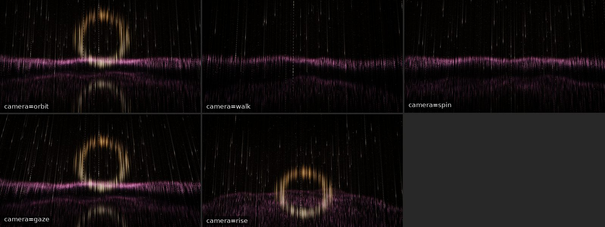

Query: `t=110` with `camera=orbit`, `camera=walk`, `camera=spin`,
`camera=gaze`, `camera=rise`. A still shows where each move has the eye at
one time; the moves themselves are slow motions.

### Field of view and distance

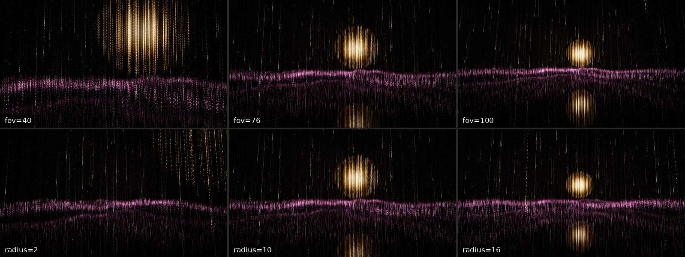

Query: `scene=crystal&form=orb&layer=on&t=30` with `fov=40`, `fov=76`,
`fov=100`; then `radius=2`, `radius=10`, `radius=16`.

## Ripples

| Panel | URL key | Values | Default | What you see |
| --- | --- | --- | --- | --- |
| Auto interval, about (s, 0: none) | `ripples` | 0 to 30 | `14` | A ripple also comes by itself, about this often (from half to twice the time). `0`: none. Any other value is at least 1 second. In the `repaint` mode an interval over 6 seconds is cut to 6. |

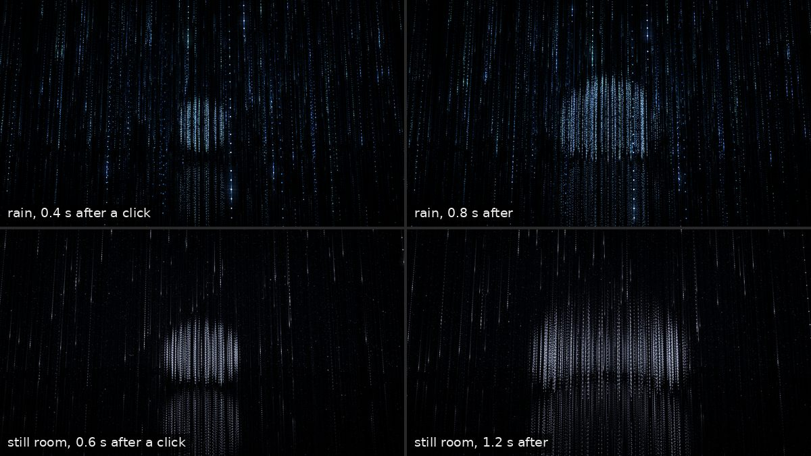

Query: `scene=rain&flow=down&weather=drizzle&color=mono&palette=deep+sea&rainShare=0.3&t=30`
(top) and `scene=crystal&form=none&layer=off&t=30` (bottom), with a click in
the middle of the view.

In the rain a ripple is a round wave. In a still room it is a ring that
spreads level, like one on water, lighting the strands as it passes. A tap
sets it off about where the forms are. Each ripple rings a bell.

## Meditation

| Panel | URL key | Values | Default | What you see |
| --- | --- | --- | --- | --- |
| Breathing guide | `breath` | `on`, `off` | `on` | The light and the pad swell as you breathe in (4 parts) and fade as you breathe out (6 parts). |
| Breaths per minute | `breathRate` | 3 to 12 | `6` | How fast the guide breathes. |
| Depth of the swell | `breathDepth` | 0 to 0.8 | `0.3` | How much the light dims at the bottom of a breath. |

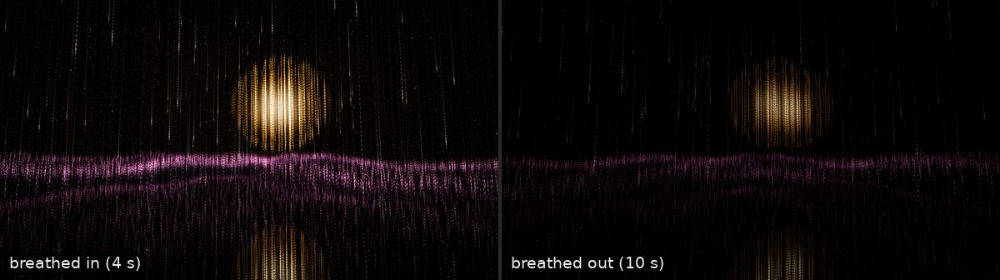

Query: `scene=crystal&form=orb&layer=on&t=30&breath=on&breathDepth=0.8`,
4 seconds and 10 seconds after the start (6 breaths a minute: one breath
is 10 seconds). The default depth, 0.3, is gentler.

## Sound

| Panel | URL key | Values | Default | What you hear |
| --- | --- | --- | --- | --- |
| Volume | `volume` | 0 to 1 | `0.8` | The whole sound. The volume bar by the buttons is the same setting. |
| **Pad** | `music` | 0 to 1 | `0.6` | The slow pad in D major. |
| **Bells** | `chimes` | 0 to 1 | `0.6` | The ripples' bells, and the still room's high notes. |
| **Rain** | `rainSound` | 0 to 1 | `0.3` | The hush of rain. |
| **Forms** | `formSound` | 0 to 1 | `0.4` | The voice each form brings: the orb a low hum, the spiral a turning figure, the cloud a high shimmer, the ring a glassy tone, the veil a soft air. |

`m` or the note button turns the sound on and off. Browsers start sound
only after a click or a key, so the music begins with your first one
(unless you turned the sound off: that is remembered).

The music follows what you see, at the same moment and with the same slow
fades:

- **rain**: the hush of rain swells and eases with the rain, under a slow
  pad in D major, a little veiled.
- **a form**: as it gathers, a chord of its own blooms and the pad opens.
  Each form has a voice that swells and fades with it, from the side where
  it is seen (it follows the form as it moves): the orb a warm, low hum, the
  spiral a slow figure of notes that climbs and turns, the cloud a high,
  airy shimmer, the ring a clear, glassy tone, the veil a soft, open air.
  As it leaves, the harmony comes home to D.
- **rain through a form**: both, fuller but not louder.
- **a still room**: close to silence. The pad thins out, and now and then a
  high, soft note falls, like the room's pale drops.
- **the breath**: a low tone under the pad swells as the light does.
- **a ripple**: a bell.

How the sound is made is in [design.md](design.md#6-sound).

## Not shown in pictures

- **Haze** and **Burn-out**: at the default exposure the difference is too
  faint to see in a picture of this size.
- **Black floor**: it drops glow fainter than a few levels out of 255; a
  picture cannot show that difference on most screens.
- **Quality** and `?dpr=`: they change how sharp the picture is, which a
  scaled-down picture hides.
- **Speed**, **Band speed** and **Move speed**: they are motions. A still
  shows the same picture at any speed.
- **Lowest share of strands / LEDs (auto)**: they set how far the density
  drifts over time; the Density figure shows the shares themselves.
- **Sound**: nothing to see.
